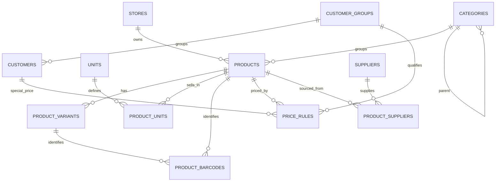
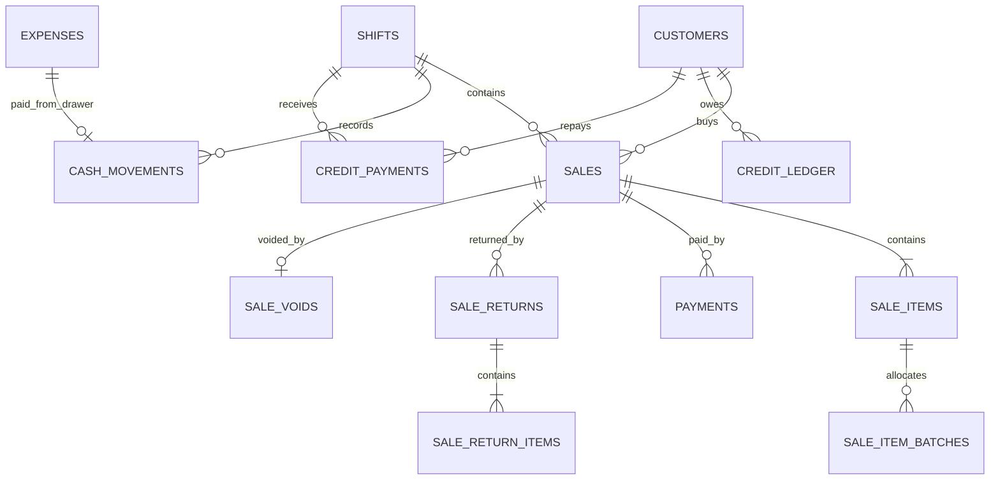
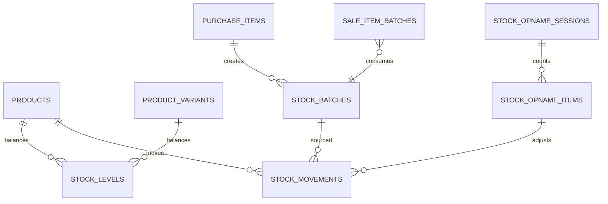
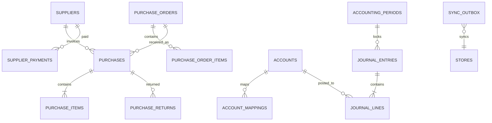

# OpenPOS — Database Schema

**Status:** Draft v1.0  
**Canonical local schema:** [`db/sqlite/0001_init.sql`](./db/sqlite/0001_init.sql)  
**Canonical cloud schema:** [`supabase/migrations/0001_init.sql`](./supabase/migrations/0001_init.sql)  
**Companion document:** [`PLAN.md`](./PLAN.md)

---

## 1. Purpose and authority

This document explains the OpenPOS data model: entities, relationships, invariants, accounting mappings, and the local-to-cloud sync contract. The SQL files are the executable source of truth for exact column definitions; this document is the source of truth for meaning and business rules.

If this document and a SQL file disagree, the SQL file is authoritative for DDL and this document must be corrected in the same change. Money/stock/accounting rule changes require updates to both documents plus a schema migration.

### Database roles

| Database | Role | Authority |
|---|---|---|
| SQLite (`db/sqlite/0001_init.sql`) | Primary operational store on each device | Source of truth for checkout, stock, cash, credit, journals |
| Supabase Postgres (`supabase/migrations/0001_init.sql`) | Optional replica, reporting, backup, multi-device convergence | Never blocks local operation; append-only ledgers are authoritative events |

SQLite runs in WAL mode with foreign keys enabled. The Electron main process is the only writer; the renderer accesses data through IPC.

### Validation performed for this draft

- SQLite schema applied to a fresh database; all views queried; `PRAGMA integrity_check` and `foreign_key_check` pass.
- Supabase schema applied twice to a clean PostgreSQL instance (idempotent re-run).
- Change-feed triggers verified on insert.
- RLS verified with two tenants: cross-store reads return zero rows, cross-store inserts are rejected, append-only tables reject updates, and `claim_store()` is idempotent while blocking a second owner.
- Supabase projects use PostgreSQL 15+; `NULLS NOT DISTINCT` and partial unique indexes are supported.

---

## 2. Design principles

1. **Local-first.** Every operational write lands in SQLite first. Cloud sync is asynchronous.
2. **UUIDv7 everywhere.** IDs are generated on the device, time-sortable, and collision-free across offline devices.
3. **Append-only ledgers for truth.** Stock movements, credit ledger entries, journal lines, voids, cash movements, and audit logs are never edited or deleted. Corrections are new reversing rows.
4. **Cached balances are disposable.** `stock_levels`, `customers.credit_balance`, `sales.due_total`, `purchases.due_total`, and `shifts.expected_cash` are caches that must reconcile to their ledgers and can be rebuilt.
5. **One event, one transaction.** A sale/return/purchase/opname/shift close writes all related rows atomically.
6. **Snapshot business facts.** Sale lines store unit, conversion factor, price, cost, tax, and discount at the moment of sale. Historical reports never depend on current product settings.
7. **Soft-delete master data.** Products, customers, suppliers, categories, and users use `deleted_at`/`is_active`; transactional history remains intact.
8. **Store-scoped rows.** Every syncable table carries `store_id`, including child tables. This makes RLS and sync simple and auditable.
9. **Type discipline.** Money is integer rupiah; quantities are decimal; timestamps are UTC; business dates are local. No floating-point money totals.
10. **Idempotent posting.** A source event can post at most one journal entry; sync upserts are safe to retry.

---

## 3. Conventions

### 3.1 Identifiers and keys

- Primary key: `id TEXT PRIMARY KEY` in SQLite (UUIDv7 string, lowercase), `uuid` in Postgres.
- Natural keys are enforced with unique indexes (barcode per store, SKU per store, receipt number per store, etc.).
- Foreign keys use `ON DELETE RESTRICT` for master data and `ON DELETE CASCADE` only for owned draft/line rows where deletion is safe.
- Composite unique keys include `store_id` to allow future multi-store use.
- Nullable variant IDs use a unique expression index in SQLite (`coalesce(variant_id,'')`) and `NULLS NOT DISTINCT` in Postgres.

### 3.2 Data types

| Logical type | SQLite | Postgres | Notes |
|---|---|---|---|
| ID | `TEXT` | `uuid` | UUIDv7 |
| Money total | `INTEGER` | `bigint` | Whole rupiah, `>= 0` unless signed movement |
| Unit cost / average cost | `REAL` | `numeric(14,4)` | Fractional rupiah per base unit |
| Quantity | `REAL` | `numeric(14,3)` | Base units, 3 decimals |
| Conversion factor | `REAL` | `numeric(14,4)` | `qty_base = qty × factor` |
| Percent | `REAL` | `numeric(7,2)` | 11.00 means 11% |
| Timestamp | `TEXT` ISO-8601 UTC | `timestamptz` | Always end with `Z` |
| Business date | `TEXT` `YYYY-MM-DD` | `date` | Store-local date |
| Boolean | `INTEGER` 0/1 + CHECK | `boolean` | Never text |
| JSON | `TEXT` + `json_valid()` | `jsonb` | Attributes, payloads, settings |
| Enum | `TEXT` + CHECK | `text` + CHECK | Kept as text for sync simplicity |

### 3.3 Timestamps and dates

- `created_at`, `updated_at`, `posted_at`, `voided_at`: UTC ISO-8601 (`2026-11-21T03:15:22.123Z`).
- `business_date`, `invoice_date`, `due_date`, `expiry_date`: local calendar dates (`YYYY-MM-DD`).
- `period_key`: `YYYY-MM` for accounting periods.
- `updated_at` is set by the application on every mutable-row update. Cloud LWW comparisons use these client-set timestamps; server-side dashboard edits must set `updated_at` explicitly.
- Clock changes are an application concern; the database stores whatever the app writes.

### 3.4 Status vocabularies

| Entity | Statuses |
|---|---|
| Sale | `held`, `completed`, `voided` |
| Sale payment | `unpaid`, `partial`, `paid`, `refunded` |
| Payment | `settled`, `pending`, `failed`, `voided` |
| Return | `posted`, `voided` |
| Shift | `open`, `closed`, `reconciled` |
| Purchase order | `draft`, `ordered`, `partially_received`, `received`, `cancelled` |
| Purchase | `draft`, `posted`, `voided` |
| Opname session | `draft`, `counting`, `finalized`, `cancelled` |
| Journal entry | `posted`, `voided` |
| Accounting period | `open`, `closed` |
| Credit ledger entry | `charge`, `payment`, `adjustment`, `write_off`, `return_credit`, `opening` |
| Stock movement | `opening`, `purchase`, `purchase_return`, `sale`, `sale_return`, `adjustment`, `opname`, `waste`, `expiry`, `transfer_in`, `transfer_out` |
| Cash movement | `sale`, `refund`, `credit_payment`, `supplier_payment`, `expense`, `cash_in`, `cash_out`, `adjustment` |
| Journal source | `sale`, `sale_return`, `sale_void`, `purchase`, `purchase_return`, `supplier_payment`, `credit_payment`, `expense`, `stock_adjustment`, `opname`, `shift_close`, `opening_balance`, `manual` |

### 3.5 Sign conventions

- **Stock:** `qty_delta` is signed. Purchase/receipt/return-in positive; sale/return-out/waste negative.
- **Cash:** `cash_movements.amount` is signed. Inflow positive; outflow negative.
- **Credit ledger:** positive = customer owes more; negative = customer paid/credited. `customers.credit_balance` is the sum.
- **Journal:** debit and credit are separate non-negative columns; exactly one is non-zero per line.
- **Sales:** `due_total >= 0`; `paid_total <= grand_total`; `change_total >= 0`.
- **Returns:** quantities and refunds are stored positive; the effect is applied as a reversal.

### 3.6 Naming

- Tables: plural snake_case.
- Columns: singular snake_case.
- Money columns end with `_amount` for transaction amounts or are named totals (`subtotal`, `grand_total`); per-unit costs use `unit_cost` / `avg_cost`.
- Boolean columns start with `is_` or `allow_` where applicable.
- Foreign keys end with `_id`.
- Views start with `v_`.
- Indexes: `ix_<table>_<columns>`, unique: `ux_<table>_<columns>`.

---

## 4. Relationship overview

### 4.1 Catalog and pricing



### 4.2 Sales, cash, and customers



### 4.3 Inventory



### 4.4 Purchasing, accounting, and sync



### 4.5 Domain boundaries

| Domain | Tables |
|---|---|
| Core / access | `stores`, `app_settings`, `users`, `roles`, `permissions`, `role_permissions`, `activity_logs`, `document_sequences`, `printers` |
| Catalog / pricing | `categories`, `units`, `products`, `product_variants`, `product_units`, `product_barcodes`, `customer_groups`, `price_rules`, `product_suppliers` |
| Inventory | `stock_levels`, `stock_batches`, `stock_movements`, `stock_opname_sessions`, `stock_opname_items` |
| Sales / cash | `shifts`, `cash_movements`, `sales`, `sale_items`, `sale_item_batches`, `payments`, `sale_returns`, `sale_return_items`, `sale_voids` |
| Customers / credit | `customers`, `credit_ledger`, `credit_payments` |
| Purchasing | `suppliers`, `purchase_orders`, `purchase_order_items`, `purchases`, `purchase_items`, `supplier_payments`, `purchase_returns`, `purchase_return_items` |
| Expenses | `expense_categories`, `expenses` |
| Accounting | `accounts`, `account_mappings`, `accounting_periods`, `journal_entries`, `journal_lines` |
| Sync (local only) | `sync_outbox`, `sync_state`, `sync_conflicts` |
| Cloud only | `store_members`, `change_feed` |

## 5. Table catalog

Column lists below are the logical schema. Types follow §3.2. Every table has `store_id` unless marked otherwise. Full constraints, defaults, and indexes are in the SQL files.

### 5.1 Core and access

#### `stores`
`id` · `name` · `legal_name` · `address` · `phone` · `email` · `npwp` · `currency` · `timezone` · `tax_enabled` · `tax_rate` · `tax_inclusive` · `rounding_increment` · `receipt_header` · `receipt_footer` · `logo_path` · `is_active` · `created_at` · `updated_at` · `deleted_at`

- One row per installation/store in v1.
- `timezone` defaults to `Asia/Jakarta`; `currency` defaults to `IDR`.
- `rounding_increment` is 0 or a positive integer (default 100).
- Deletion is not exposed in the UI; `deleted_at` exists for archival.

#### `app_settings`
`store_id` · `key` · `value_json` · `scope` (`device` | `store`) · `is_secret` · `updated_at` · PK (`store_id`, `key`)

- Device-scoped settings: printer selection, device code, local backup folder, sync cursors.
- Store-scoped settings: receipt footer, default tax, low-stock defaults.
- `is_secret = 1` values are encrypted by the app and never synced (Supabase tokens, optional SMTP/WhatsApp tokens).
- Supabase URL and anon key are stored here with `scope='device'`; they are not uploaded.

#### `users`
`id` · `store_id` · `name` · `username` · `pin_hash` · `role_id` · `phone` · `email` · `is_active` · `must_change_pin` · `last_login_at` · `created_at` · `updated_at` · `deleted_at`

- `username` unique per store (case-insensitive).
- `pin_hash` is Argon2id; this column is **local-only** and is never included in sync payloads.
- Users with transactions cannot be deleted; deactivate instead.
- `role_id` references `roles`.

#### `roles`
`id` · `store_id` · `name` · `slug` · `description` · `is_system` · `created_at` · `updated_at`

- System roles: `owner`, `manager` (optional), `cashier`. `is_system=1` prevents deletion and critical permission removal.
- Custom roles copy a base template.

#### `permissions`
`key` · `group_name` · `description`

- Global reference table, seeded by the migration. Not store-scoped.
- Keys are stable and used in UI and IPC guards (see PLAN §11.7).

#### `role_permissions`
`store_id` · `role_id` · `permission_key` · `created_at` · PK (`role_id`, `permission_key`)

- Additive permissions. No explicit deny rows in v1.
- Owner role is validated by the application to contain all permissions.

#### `activity_logs`
`id` · `store_id` · `user_id` · `action` · `entity_type` · `entity_id` · `before_json` · `after_json` · `reason` · `metadata_json` · `created_at`

- Append-only. No `updated_at`, no delete path.
- `action` examples: `sale.void`, `sale.return`, `product.price_change`, `stock.adjust`, `opname.finalize`, `credit.limit_change`, `purchase.void`, `settings.update`, `auth.login_failed`, `sync.conflict_resolve`.
- Secrets are redacted before writing.

#### `document_sequences`
`id` · `store_id` · `doc_type` · `period_key` · `prefix` · `next_value` · `padding` · `updated_at` · UNIQUE (`store_id`, `doc_type`, `period_key`, `prefix`)

- Allocated inside the same transaction as the document.
- `doc_type`: `sale`, `return`, `void`, `purchase`, `po`, `credit_payment`, `supplier_payment`, `journal`.
- `period_key` is `YYYYMMDD` for daily documents and `YYYYMM` for journals.
- Prefix includes the device code, e.g. `INV-K1`.

#### `printers` (local only)
`id` · `store_id` · `name` · `connection` (`usb` | `bluetooth` | `network` | `system`) · `address` · `vendor_id` · `product_id` · `paper_width` (58 | 80) · `chars_per_line` · `is_default` · `is_active` · `created_at` · `updated_at`

- Never synced: printer names, COM ports, and IP addresses are device-specific.
- A printer profile can be cloned manually on another device.

### 5.2 Catalog and pricing

#### `categories`
`id` · `store_id` · `parent_id` · `name` · `sort_order` · `is_active` · `created_at` · `updated_at` · `deleted_at`

- One-level nesting supported by the UI; schema allows deeper trees.
- Name unique among siblings per store.
- Deleting a category with products is blocked until products are reassigned.

#### `units`
`id` · `store_id` · `code` · `name` · `allow_decimal` · `is_active` · `created_at` · `updated_at`

- Seed examples: `pcs`, `sachet`, `pack`, `dus`, `box`, `bal`, `renteng`, `slop`, `kg`, `gram`, `liter`, `ml`.
- `code` unique per store.
- `allow_decimal=1` for kg/liter; conversion still uses `factor_to_base`.

#### `products`
`id` · `store_id` · `sku` · `name` · `category_id` · `base_unit_id` · `brand` · `description` · `cost_price` · `retail_price` · `min_stock_qty` · `track_stock` · `track_expiry` · `shelf_life_days` · `is_taxable` · `tax_rate` · `image_path` · `is_active` · `created_at` · `updated_at` · `deleted_at`

- `base_unit_id` is the stock-keeping unit for the product (usually pcs, gram, or ml).
- `cost_price` is the last known cost per base unit; the moving average lives in `stock_levels.avg_cost`.
- `retail_price` is the fallback price per base unit. Unit/variant/rule prices override it.
- `min_stock_qty` defaults to 0; low stock uses `<=`.
- `track_stock=0` for services or non-inventory items; sales skip stock movements.
- `track_expiry=1` prompts for batches and enables FEFO/expiry alerts.
- SKU unique per store when present; products can be identified by barcode only.
- Soft delete preserves sale history.

#### `product_variants`
`id` · `store_id` · `product_id` · `sku` · `name` · `attributes_json` · `retail_price` · `cost_price` · `is_active` · `sort_order` · `created_at` · `updated_at` · `deleted_at`

- A variant is a separate stock-keeping unit under the same product and unit hierarchy.
- `retail_price` and `cost_price` are nullable overrides per base unit.
- `attributes_json` example: `{"size":"1L","flavor":"original"}`.
- SKU unique per store when present.
- A product with no variants uses `variant_id = NULL` on sales and stock rows.

#### `product_units`
`id` · `store_id` · `product_id` · `unit_id` · `parent_unit_id` · `factor_to_parent` · `factor_to_base` · `selling_price` · `is_base` · `is_default_sale` · `is_default_purchase` · `sort_order` · `created_at` · `updated_at`

- UNIQUE (`product_id`, `unit_id`).
- Exactly one `is_base=1` row per product (partial unique index).
- `factor_to_base` is authoritative; `factor_to_parent` is for display/entry validation.
- `selling_price` is per selected unit; NULL falls back to `retail_price × factor_to_base`.
- `is_default_sale` and `is_default_purchase` select the default unit in the UI.
- Example: base pcs; dus factor 24; bal factor 288, parent dus, factor_to_parent 12.

#### `product_barcodes`
`id` · `store_id` · `product_id` · `variant_id` · `unit_id` · `barcode` · `is_primary` · `created_at`

- UNIQUE (`store_id`, `barcode`).
- A barcode can point to a product, a variant, or a specific unit (bal barcode).
- Multiple barcodes per item allowed (old and new packaging).
- Barcode search returns the mapped unit directly, so scanning a bal barcode adds one bal.

#### `customer_groups`
`id` · `store_id` · `name` · `price_tier` (`retail` | `wholesale` | `member` | `custom`) · `default_discount_percent` · `is_default` · `created_at` · `updated_at`

- Default groups: Retail, Grosir, Langganan.
- Exactly one default group per store (partial unique index).
- `default_discount_percent` applies only when no price rule matches.

#### `price_rules`
`id` · `store_id` · `name` · `scope` (`product` | `variant` | `category`) · `product_id` · `variant_id` · `category_id` · `customer_id` · `customer_group_id` · `unit_id` · `min_qty` · `price` · `discount_percent` · `priority` · `starts_at` · `ends_at` · `is_active` · `created_at` · `updated_at`

- Target constraint: exactly one of `product_id`, `variant_id`, `category_id` is non-null.
- Price constraint: exactly one of `price`, `discount_percent` is non-null.
- `min_qty` is in the rule's `unit_id` if provided; otherwise in base units.
- Resolution order is defined in PLAN §11.2; `priority` breaks equally specific ties.
- Customer-specific > customer-group > quantity-wholesale > unit price > variant price > product price.
- `starts_at`/`ends_at` are UTC timestamps; the app converts them to store time for display.
- Deleting a rule is a soft deactivate; historical sale lines keep `price_rule_id` for audit.

#### `product_suppliers`
`id` · `store_id` · `product_id` · `variant_id` · `supplier_id` · `supplier_sku` · `last_cost` · `last_purchase_at` · `is_preferred` · `created_at` · `updated_at`

- UNIQUE (`product_id`, `variant_id`, `supplier_id`) using the null-safe variant expression.
- At most one preferred supplier per product/variant.
- `last_cost` is per base unit; updated on purchase posting.
- Used for restock suggestions and supplier price comparison.

### 5.3 Inventory

#### `stock_levels`
`id` · `store_id` · `product_id` · `variant_id` · `qty_on_hand` · `qty_reserved` · `avg_cost` · `last_cost` · `updated_at` · UNIQUE (`store_id`, `product_id`, `variant_id`)

- Cached balance in base units. `qty_reserved` is for future held-cart reservations; v1 keeps it 0.
- `avg_cost` is the moving weighted average cost per base unit.
- `last_cost` is the most recent purchase cost per base unit.
- Created on first movement; missing rows are treated as zero stock.
- Must equal `sum(stock_movements.qty_delta)`; a repair action recomputes it.

#### `stock_batches`
`id` · `store_id` · `product_id` · `variant_id` · `purchase_item_id` · `batch_no` · `expiry_date` · `qty_received` · `qty_remaining` · `unit_cost` · `received_at` · `created_at`

- Created on purchase receipt and opening stock.
- `qty_remaining` is decremented by sale allocations and increments on sale returns when restocked.
- `expiry_date` nullable; when present, FEFO orders by earliest expiry.
- `unit_cost` is per base unit for batch-level analysis; COGS still uses moving average.
- `qty_remaining` may be 0 but never negative.

#### `stock_movements`
`id` · `store_id` · `product_id` · `variant_id` · `batch_id` · `movement_type` · `qty_delta` · `qty_input` · `unit_id` · `conversion_factor` · `unit_cost` · `total_cost` · `reference_type` · `reference_id` · `reason` · `note` · `business_date` · `user_id` · `created_at`

- Immutable append-only ledger. `qty_delta` is signed base units.
- `qty_input` and `unit_id` preserve what the user entered (e.g. 2 bal).
- `unit_cost` is per base unit; `total_cost` is signed integer rupiah for the movement.
- `reference_type` examples: `sale`, `sale_return`, `purchase`, `purchase_return`, `opname`, `adjustment`, `opening`.
- `movement_type` and `reference_type` are related but not identical: a `sale` movement references `sale`; a `waste` movement may reference `adjustment`.
- `business_date` is the local date used in stock-card and valuation reports.
- No `updated_at`; corrections create new movements.

#### `stock_opname_sessions`
`id` · `store_id` · `name` · `scope_json` · `status` · `started_by` · `started_at` · `finalized_by` · `finalized_at` · `notes` · `created_at`

- `scope_json` stores the filter used (category IDs, product IDs, or `all`).
- Only one active session per scope is allowed by the application.
- Finalized sessions are immutable; corrections require a new adjustment.

#### `stock_opname_items`
`id` · `store_id` · `session_id` · `product_id` · `variant_id` · `system_qty` · `counted_qty` · `difference_qty` · `unit_cost` · `reason` · `created_at`

- `system_qty` snapshot at count time (or hidden in blind-count mode).
- `difference_qty = counted_qty - system_qty`.
- `unit_cost` snapshot at finalization; shortages are valued at moving average.
- A finalized item creates exactly one `opname` stock movement when `difference_qty != 0`.

### 5.4 Sales, shifts, and cash

#### `shifts`
`id` · `store_id` · `register_name` · `device_id` · `opened_by` · `opened_at` · `opening_cash` · `closed_by` · `closed_at` · `expected_cash` · `counted_cash` · `difference` · `status` · `closing_note` · `business_date` · `created_at` · `updated_at`

- At most one `open` shift per `device_id` (partial unique index).
- `expected_cash` is snapshotted at close from opening cash + cash movements.
- `difference = counted_cash − expected_cash`; positive = over, negative = short.
- `business_date` is the opening local date; sales keep their own dates.
- Closed shifts are immutable; corrections use `adjustment` cash movements in a later shift.

#### `cash_movements`
`id` · `store_id` · `shift_id` · `type` · `amount` · `reference_type` · `reference_id` · `note` · `business_date` · `user_id` · `created_at`

- Signed rupiah: inflow positive, outflow negative.
- Types: `sale`, `refund`, `credit_payment`, `supplier_payment`, `expense`, `cash_in`, `cash_out`, `adjustment`.
- Opening cash is **not** a movement; it lives on `shifts.opening_cash` to avoid double counting.
- Every row references the source document where applicable.
- Append-only; voiding a source creates a reversing movement.

#### `sales`
`id` · `store_id` · `shift_id` · `receipt_no` · `business_date` · `customer_id` · `cashier_id` · `status` · `payment_status` · `price_tier` · `hold_label` · `hold_note` · `hold_expires_at` · `subtotal` · `item_discount_total` · `order_discount_total` · `tax_total` · `rounding_total` · `grand_total` · `paid_total` · `change_total` · `due_total` · `cost_total` · `note` · `held_at` · `completed_at` · `voided_at` · `voided_by` · `void_reason` · `created_at` · `updated_at`

- UNIQUE (`store_id`, `receipt_no`) where `receipt_no IS NOT NULL` (held carts have no receipt number until completed).
- `status='held'` carts hold items but no payments, stock movements, cash, credit, or journals.
- `grand_total = subtotal − item_discount_total − order_discount_total + tax_total + rounding_total`.
- `paid_total = sum(payments.amount)`; `due_total = grand_total − paid_total` for credit sales.
- `change_total = sum(payments.change_amount)`; it is informational and does not reduce `grand_total`.
- `cost_total` is the COGS snapshot from sale items.
- `payment_status`: `unpaid`, `partial`, `paid`, `refunded`; updated on payments, returns, and voids.
- Voiding sets `status='voided'`, `voided_at`, `voided_by`, `void_reason`; rows are never deleted.
- Held carts can be deleted only if they never completed; deletion is an audit event.

#### `sale_items`
`id` · `store_id` · `sale_id` · `line_no` · `product_id` · `variant_id` · `unit_id` · `qty` · `conversion_factor` · `qty_base` · `unit_price` · `price_source` · `price_rule_id` · `discount_percent` · `discount_amount` · `tax_rate` · `tax_amount` · `gross_amount` · `line_total` · `unit_cost_base` · `cost_total` · `note`

- Snapshot row: changing product prices later never changes this line.
- `qty` is in the selected unit; `qty_base = qty × conversion_factor`.
- `unit_price` is per selected unit; `gross_amount = round(qty × unit_price)`.
- `price_source`: `customer`, `group`, `wholesale`, `unit`, `variant`, `product`, `manual`.
- `line_total = gross_amount − discount_amount + tax_amount`.
- `unit_cost_base` is the moving average at sale time; `cost_total = round(qty_base × unit_cost_base)`.
- `tax_rate` is the applied rate in percent (0 when tax disabled).

#### `sale_item_batches`
`id` · `store_id` · `sale_item_id` · `batch_id` · `qty_base` · `unit_cost`

- Records FEFO allocation. A line can split across multiple batches.
- Sum of allocations equals the line's `qty_base` for stock-tracked products with batches.
- `unit_cost` is the batch cost for analysis; COGS still uses the line's moving average.
- Deleting a sale line cascades its allocations (only while the sale is held/draft).

#### `payments`
`id` · `store_id` · `sale_id` · `shift_id` · `method` · `amount` · `tendered_amount` · `change_amount` · `reference_no` · `provider` · `status` · `paid_at` · `received_by` · `note` · `created_at`

- Methods: `cash`, `bank_transfer`, `ewallet`, `qris`, `other`.
- `amount` is the portion applied to the sale; `tendered_amount` is cash received (cash only).
- `change_amount = tendered_amount − amount` for cash; 0 for other methods.
- Multiple rows per sale support split payments.
- `status`: `settled` (default for manual confirmation), `pending` (future gateway), `failed`, `voided`.
- Cash payments create a cash movement for `amount` (not tendered).
- Payment rows are never deleted; voids set `status='voided'`.

#### `sale_returns`
`id` · `store_id` · `sale_id` · `return_no` · `business_date` · `reason_code` · `reason` · `refund_method` · `refund_amount` · `restock` · `status` · `processed_by` · `shift_id` · `created_at`

- UNIQUE (`store_id`, `return_no`).
- `reason_code`: `damaged`, `expired`, `wrong_item`, `changed_mind`, `other`.
- `refund_method`: `original`, `cash`, `bank_transfer`, `ewallet`, `qris`.
- `restock=1` returns goods to sellable stock; `0` sends them to waste/quarantine.
- `status`: `posted`, `voided`; voiding a return reverses its effects with audit.
- Return amount cannot exceed the remaining refundable amount of the sale.

#### `sale_return_items`
`id` · `store_id` · `return_id` · `sale_item_id` · `product_id` · `variant_id` · `unit_id` · `qty` · `conversion_factor` · `qty_base` · `unit_price` · `refund_amount` · `restock`

- Quantity validated against `sale_items.qty` minus prior returns.
- `refund_amount = round(qty × unit_price)` minus proportional discount, snapshotted.
- Each line creates a `sale_return` stock movement (positive when restocked, zero/waste otherwise).
- Returned cost uses the original sale line's `unit_cost_base`.

#### `sale_voids`
`id` · `store_id` · `sale_id` · `reason` · `voided_by` · `approved_by` · `shift_id` · `created_at`

- UNIQUE (`sale_id`).
- Append-only; no updates.
- Both actor and approver are recorded (approver nullable when not required).
- The sale header also carries denormalized void fields for fast reporting.

### 5.5 Customers and credit

#### `customers`
`id` · `store_id` · `name` · `phone` · `phone_normalized` · `email` · `address` · `customer_group_id` · `credit_limit` · `credit_term_days` · `credit_balance` · `notes` · `is_active` · `created_at` · `updated_at` · `deleted_at`

- `phone_normalized` strips spaces, dashes, and country-code variants for search; not necessarily unique.
- `credit_limit` is the maximum outstanding receivable; 0 means cash-only unless overridden.
- `credit_term_days` defaults to 30; used to compute charge due dates.
- `credit_balance` is cached; must equal the sum of `credit_ledger.amount`.
- Soft delete preserves credit and sales history; inactive customers cannot take new credit.

#### `credit_ledger`
`id` · `store_id` · `customer_id` · `entry_type` · `amount` · `balance_after` · `sale_id` · `due_date` · `reference_type` · `reference_id` · `note` · `created_by` · `created_at`

- Append-only signed ledger. Positive increases receivable; negative reduces it.
- `entry_type`: `opening`, `charge`, `payment`, `adjustment`, `write_off`, `return_credit`, `void`.
- `sale_id` is set for charges and sale-linked returns.
- `due_date` is set on charges (business date + term days); used for aging.
- `balance_after` is the customer balance after applying this row; used for statements and integrity checks.
- A credit payment creates one negative entry, or one per invoice when allocated across invoices.
- Never update or delete; corrections create opposite entries.

#### `credit_payments`
`id` · `store_id` · `customer_id` · `shift_id` · `amount` · `method` · `reference_no` · `note` · `paid_at` · `received_by` · `created_at` · `voided_at` · `void_reason`

- Records the cash/bank/e-wallet receipt from a customer.
- Cash payments create a `credit_payment` cash movement and a journal (Dr Cash, Cr AR).
- Linked ledger entries set `reference_type='credit_payment'`, `reference_id=credit_payments.id`.
- Overpayment is rejected in v1.
- Voiding creates reversing ledger and cash entries and sets `voided_at`/`void_reason`.

### 5.6 Purchasing and suppliers

#### `suppliers`
`id` · `store_id` · `name` · `code` · `contact_name` · `phone` · `email` · `address` · `payment_term_days` · `notes` · `is_active` · `created_at` · `updated_at` · `deleted_at`

- `code` unique per store when present.
- `payment_term_days` drives purchase due dates (default 0 = due immediately).
- Soft delete preserves purchase history.

#### `purchase_orders`
`id` · `store_id` · `po_no` · `supplier_id` · `status` · `order_date` · `expected_date` · `subtotal` · `discount_total` · `tax_total` · `grand_total` · `notes` · `created_by` · `approved_by` · `created_at` · `updated_at`

- `po_no` unique per store.
- Status transitions: `draft` → `ordered` → `partially_received`/`received`; `cancelled` before receipt.
- Totals are estimates; actual costs are captured on `purchases`.
- Receiving updates line `qty_received` and the PO status.

#### `purchase_order_items`
`id` · `store_id` · `purchase_order_id` · `product_id` · `variant_id` · `unit_id` · `qty` · `conversion_factor` · `unit_cost` · `line_total` · `qty_received`

- `qty` in purchase unit; `line_total = round(qty × unit_cost)`.
- `qty_received` accumulates across partial receipts and cannot exceed `qty` unless over-receipt is enabled.

#### `purchases`
`id` · `store_id` · `purchase_no` · `supplier_invoice_no` · `purchase_order_id` · `supplier_id` · `status` · `invoice_date` · `due_date` · `subtotal` · `discount_total` · `tax_total` · `shipping_total` · `grand_total` · `paid_total` · `due_total` · `notes` · `created_by` · `posted_by` · `posted_at` · `created_at` · `updated_at`

- `purchase_no` unique per store; supplier invoice number is stored but not required unique.
- `grand_total = subtotal − discount_total + tax_total + shipping_total`.
- `due_total = grand_total − paid_total − purchase_returns.total_amount`; never negative.
- Posting creates stock, batches, AP, and journals. `status='draft'` has no stock/accounting effect.
- Voiding reverses stock only if the received quantity is still available; otherwise it is blocked.
- `due_date` defaults from supplier terms.

#### `purchase_items`
`id` · `store_id` · `purchase_id` · `product_id` · `variant_id` · `unit_id` · `qty` · `conversion_factor` · `qty_base` · `unit_cost` · `unit_cost_base` · `discount_amount` · `line_total` · `expiry_date` · `batch_no` · `created_at`

- `qty` in purchase unit; `qty_base = qty × conversion_factor`.
- `unit_cost` per purchase unit; `unit_cost_base = unit_cost / conversion_factor`.
- `line_total = round(qty × unit_cost) − discount_amount`.
- Creates one batch and one positive stock movement on posting.
- Price history is queried directly from this table (optionally via `v_purchase_price_history`).

#### `supplier_payments`
`id` · `store_id` · `supplier_id` · `purchase_id` · `shift_id` · `amount` · `method` · `reference_no` · `note` · `paid_at` · `status` · `created_by` · `created_at` · `voided_at` · `void_reason`

- `purchase_id` nullable for on-account payments; v1 UI pays one invoice at a time for clarity.
- Methods: `cash`, `bank_transfer`, `ewallet`, `other`.
- Cash payments create a `supplier_payment` cash movement and reduce drawer cash.
- Payment updates `purchases.paid_total` and `due_total` in the same transaction.
- Voiding reverses cash and AP effects and restores the due amount.

#### `purchase_returns`
`id` · `store_id` · `purchase_id` · `supplier_id` · `return_no` · `business_date` · `reason` · `total_amount` · `status` · `created_by` · `created_at`

- `return_no` unique per store.
- Reduces payable and inventory; creates negative stock movements.
- `status`: `posted`, `voided`.
- Reasons: damaged, expired, short delivery, wrong item, other.

#### `purchase_return_items`
`id` · `store_id` · `return_id` · `purchase_item_id` · `product_id` · `variant_id` · `unit_id` · `qty` · `qty_base` · `unit_cost` · `line_total`

- Quantity limit: received quantity minus prior returns.
- `unit_cost` is the original purchase base cost; `line_total = round(qty_base × unit_cost)`.
- Stock removal is blocked if it would make on-hand negative, unless the owner overrides with audit.

### 5.7 Expenses

#### `expense_categories`
`id` · `store_id` · `name` · `is_active` · `created_at` · UNIQUE (`store_id`, `name`)

- Seed: `Kantong plastik`, `Token listrik`, `Makan staf`, `Transport`, `Kebersihan`, `Sewa`, `Internet`, `Lain-lain`.
- Cannot delete a category with expenses; deactivate instead.

#### `expenses`
`id` · `store_id` · `shift_id` · `category_id` · `amount` · `paid_from` · `description` · `reference_no` · `business_date` · `spent_at` · `created_by` · `created_at` · `voided_at` · `void_reason`

- `paid_from`: `cash_drawer`, `bank`, `ewallet`, `other`.
- Cash-drawer expenses create a negative cash movement; others do not affect the drawer.
- `amount > 0`; no negative expenses (use a void or adjustment).
- Voiding reverses cash and journal effects and requires a reason.
- Receipt photo path may be stored in `reference_no` metadata or an attachment table (future).

### 5.8 Accounting

#### `accounts`
`id` · `store_id` · `code` · `name` · `type` (`asset` | `liability` | `equity` | `revenue` | `expense`) · `normal_balance` (`debit` | `credit`) · `parent_id` · `is_system` · `is_active` · `created_at` · `updated_at`

- UNIQUE (`store_id`, `code`).
- System accounts are seeded and cannot be deleted; names can be edited.
- Parent accounts group children for reporting; only leaf accounts should receive journal lines.
- Standard chart is documented in PLAN §11.10.

#### `account_mappings`
`id` · `store_id` · `mapping_key` · `account_id` · `created_at` · `updated_at` · UNIQUE (`store_id`, `mapping_key`)

- Maps event roles to accounts. Keys: `cash_drawer`, `bank`, `ewallet_clearing`, `qris_clearing`, `accounts_receivable`, `inventory`, `accounts_payable`, `sales_revenue`, `sales_returns`, `sales_discount`, `cogs`, `inventory_adjustment`, `cash_over_short`, `tax_output`, `tax_input`, `rounding`, `owner_equity`, `owner_drawings`, `opening_balance_equity`, `operating_expense_default`.
- Changing a mapping affects future journals only; historical entries keep their account IDs.

#### `accounting_periods`
`id` · `store_id` · `period_key` · `status` · `closed_by` · `closed_at` · `created_at` · `updated_at` · UNIQUE (`store_id`, `period_key`)

- `period_key` is `YYYY-MM`.
- Posting into a `closed` period is blocked; reopening requires owner permission and a reason (audited).
- Periods are created lazily when the first journal in that month is posted.

#### `journal_entries`
`id` · `store_id` · `entry_no` · `entry_date` · `period_key` · `source_type` · `source_id` · `description` · `status` · `reversal_of_id` · `created_by` · `posted_at` · `voided_at` · `voided_by` · `void_reason` · `created_at` · `updated_at`

- UNIQUE (`store_id`, `entry_no`).
- UNIQUE (`store_id`, `source_type`, `source_id`) for idempotent auto-posting.
- `entry_date` is the accounting date (normally the business date).
- `status`: `posted`, `voided`; reversing entries reference `reversal_of_id`.
- Auto entries are created in the same transaction as the source event.
- Manual entries are allowed only with `accounting.post`.

#### `journal_lines`
`id` · `store_id` · `journal_entry_id` · `line_no` · `account_id` · `debit` · `credit` · `memo` · `customer_id` · `supplier_id` · `created_at`

- Exactly one of `debit`, `credit` is > 0; the other is 0.
- `debit >= 0`, `credit >= 0`, integers.
- Sum of debits must equal sum of credits per entry (validated by the service and integrity queries).
- Immutable; corrections use reversing entries.
- `customer_id`/`supplier_id` support subledger drill-down (AR/AP).

### 5.9 Sync tables (local only)

#### `sync_outbox`
`id` (autoincrement) · `store_id` · `op_id` · `table_name` · `row_id` · `operation` (`upsert` | `delete`) · `payload_json` · `base_updated_at` · `created_at` · `synced_at` · `attempts` · `last_error`

- Written in the same transaction as the domain change.
- `op_id` is a UUID used for idempotency; unique.
- Batches are pushed in dependency order; `synced_at` marks success.
- Failed rows remain and retry with backoff; `attempts` and `last_error` support diagnostics.
- Payloads exclude local-only and secret fields.

#### `sync_state`
`key` · `value_json` · `updated_at`

- Keys: `cloud_enabled`, `supabase_url`, `supabase_anon_key`, `auth_user_id`, `store_claimed`, `initial_upload_completed`, `last_pull_seq`, `last_push_at`, `last_pull_at`, `device_code`, `schema_hash`.
- Secrets (refresh token) live in encrypted app settings, not here.
- Local cursor is a `bigint` serialized as a string to avoid precision loss.

#### `sync_conflicts`
`id` · `store_id` · `table_name` · `row_id` · `local_json` · `remote_json` · `status` (`open` | `resolved` | `ignored`) · `resolution` (`local` | `cloud` | `merged`) · `resolved_by` · `created_at` · `resolved_at`

- Created when both local and remote rows changed since the last common base.
- Financial amounts are never auto-merged; the user chooses.
- Resolving a conflict records an activity log and enqueues the chosen version.

### 5.10 Cloud-only tables

#### `store_members`
`user_id` (auth.users) · `store_id` · `role` (`owner` | `member`) · `created_at` · PK (`user_id`, `store_id`)

- Maps Supabase Auth users to stores for RLS.
- Created by `claim_store()` for the first owner; additional members are managed in the Supabase dashboard in v1.
- No direct client inserts; policies allow reading own memberships.

#### `change_feed`
`server_seq` (identity bigserial) · `store_id` · `table_name` · `row_id` · `op` (`insert` | `update` | `delete`) · `payload_json` · `changed_at`

- Append-only change log populated by triggers on every syncable table.
- Clients pull `where store_id = current_store and server_seq > last_pull_seq` ordered by `server_seq`.
- Retention: keep 90 days by default; clients that are offline longer must run a full resync.
- `payload_json` contains the full new row (or old row for delete).

## 6. Views and reporting surfaces

Views keep report logic out of the renderer. They are read-only; materialized rollups may be added later without changing the base schema.

| View | Purpose | Key columns |
|---|---|---|
| `v_product_stock` | Product/variant stock with unit, low-stock flag, valuation | `product_id`, `variant_id`, `qty_on_hand`, `avg_cost`, `stock_value`, `is_low_stock` |
| `v_low_stock` | Active, stock-tracked items at or below threshold | `product_id`, `qty_on_hand`, `min_stock_qty`, `shortage` |
| `v_expiring_batches` | Batches with expiry, days remaining, value | `batch_id`, `expiry_date`, `days_to_expiry`, `qty_remaining` |
| `v_sale_profit` | Line-level revenue, cost, margin | `sale_id`, `product_id`, `revenue`, `cogs`, `gross_profit`, `margin_pct` |
| `v_daily_sales` | Per business date totals and payment mix | `business_date`, `gross_sales`, `returns`, `net_sales`, `transactions` |
| `v_customer_ar` | Customer balance, limit, overdue | `customer_id`, `credit_balance`, `overdue_amount`, `available_credit` |
| `v_customer_aging` | Aging buckets per customer | `current`, `days_1_30`, `days_31_60`, `days_61_90`, `days_90_plus` |
| `v_supplier_ap` | Purchase due totals and overdue | `supplier_id`, `total_due`, `overdue_amount`, `next_due_date` |
| `v_shift_summary` | Expected vs counted cash and sales mix | `shift_id`, `expected_cash`, `counted_cash`, `difference` |
| `v_trial_balance` | Account debit/credit totals and balance | `account_id`, `total_debit`, `total_credit`, `balance` |
| `v_purchase_price_history` | Cost changes by product/supplier | `product_id`, `supplier_id`, `unit_cost_base`, `invoice_date` |
| `v_inventory_valuation` | Stock value at average and last cost | `product_id`, `qty_on_hand`, `avg_value`, `last_value` |
| `v_product_sales_rank` | Units/revenue/margin by product and period | `product_id`, `units_sold`, `revenue`, `gross_profit` |
| `v_cash_flow` | Cash movement totals by day/type/account | `business_date`, `type`, `amount` |

### View rules

- Views must not join across stores; every query filters `store_id` first.
- Date filters use `business_date` for operational reports and `entry_date` for accounting.
- Voided sales, returns, and journals are excluded unless the view is explicitly an exception report (`v_voids`, `v_returns`).
- Views are defined in the SQLite migration; equivalent views/queries are provided for Supabase where useful for dashboards.
- Expensive views should be backed by indexes on `(store_id, business_date)` and `(store_id, product_id, created_at)`.

### Example: daily sales

```sql
SELECT
  s.business_date,
  COUNT(*) FILTER (WHERE s.status = 'completed') AS transactions,
  COALESCE(SUM(s.grand_total) FILTER (WHERE s.status = 'completed'), 0) AS gross_sales,
  COALESCE(SUM(s.cost_total) FILTER (WHERE s.status = 'completed'), 0) AS cogs,
  COALESCE(SUM(s.grand_total - s.cost_total) FILTER (WHERE s.status = 'completed'), 0) AS gross_profit
FROM sales s
WHERE s.store_id = ?1
  AND s.business_date BETWEEN ?2 AND ?3
GROUP BY s.business_date
ORDER BY s.business_date;
```

SQLite versions use `SUM(CASE WHEN ... THEN ... ELSE 0 END)` instead of `FILTER` for compatibility with older bundled builds; the migration uses portable syntax.

---

## 7. Business invariants

These must hold after every committed transaction. They are enforced in domain services and verified by tests and repair tools.

### 7.1 Stock

```text
For every (store, product, variant):
  stock_levels.qty_on_hand = SUM(stock_movements.qty_delta)
  stock_batches.qty_remaining >= 0
  SUM(sale_item_batches.qty_base per sale item) <= sale_items.qty_base
```

- Every sale item with `track_stock=1` has a negative stock movement of `qty_base`.
- Every posted purchase item has a positive stock movement and a batch.
- Opname finalization creates exactly one adjustment per counted item with a difference.
- Waste/expiry movements are negative and reference a reason.
- Stock levels are updated in the same transaction as movements; a repair job can recompute them.

### 7.2 Sales and payments

```text
grand_total = subtotal
            - item_discount_total
            - order_discount_total
            + tax_total
            + rounding_total

paid_total = SUM(payments.amount WHERE status = 'settled')
due_total  = grand_total - paid_total          (0 <= due_total <= grand_total)
change_total = SUM(payments.change_amount)
```

- Completed sales require `paid_total + due_total = grand_total`.
- `due_total > 0` requires a customer and a credit ledger charge of the same amount.
- Cash `change_amount` is only allowed for `method='cash'`.
- A sale with `status != 'completed'` has no stock, cash, credit, or journal effects.
- Voided sales have `paid_total = 0` after reversals (or payment rows marked `voided`) and `due_total = 0`.
- Returns cannot exceed the sold quantity minus prior returns for each sale item.
- `receipt_no` is unique per store and null only for held carts.

### 7.3 Credit

```text
customers.credit_balance = SUM(credit_ledger.amount)
credit_balance_at_charge <= credit_limit
SUM(credit_payments.amount for non-voided) = SUM(-credit_ledger.amount WHERE entry_type='payment')
```

- A credit sale cannot complete if the resulting balance would exceed the limit.
- A repayment cannot exceed the outstanding balance.
- Voiding a payment restores the balance and reverses cash.
- Aging uses charge `due_date` and remaining unallocated amount.

### 7.4 Cash and shifts

```text
expected_cash = opening_cash + SUM(cash_movements.amount)
difference    = counted_cash - expected_cash
```

- Every cash movement belongs to exactly one shift.
- A shift with sales cannot be deleted.
- Only one open shift per device.
- Closing a shift requires `counted_cash` and sets status `closed`.
- Cash sales, refunds, credit repayments, supplier payments, expenses, cash in/out all create movements exactly once.
- Reversals create opposite movements; the original row is never edited.

### 7.5 Purchasing and payables

```text
purchases.grand_total = subtotal - discount_total + tax_total + shipping_total
purchases.due_total   = grand_total - paid_total - SUM(posted purchase_returns.total_amount)
0 <= paid_total <= grand_total
```

- Posted purchases have stock movements and AP journals.
- Purchase returns cannot exceed received quantity minus prior returns.
- Supplier payments cannot exceed the remaining due amount.
- Voiding a purchase is blocked if received stock has already been sold below the returnable quantity.

### 7.6 Accounting

```text
For every journal entry:
  SUM(journal_lines.debit) = SUM(journal_lines.credit)
  every line has (debit > 0 XOR credit > 0)
  entry.period is open at posting time
  (source_type, source_id) is unique per store
```

- Every completed sale, return, void, purchase, purchase return, supplier payment, credit payment, expense, opname finalization, and shift close posts at most one journal entry (plus its reversal on void).
- Journal lines are immutable; corrections are reversals.
- AR control balance equals `SUM(customers.credit_balance)`.
- AP control balance equals `SUM(purchases.due_total)`.
- Inventory control equals `SUM(stock_levels.qty_on_hand * stock_levels.avg_cost)` rounded.
- Cash control equals the sum of open shift expected cash plus undeposited cash accounts (application-level reconciliation).

### 7.7 Data integrity rules

- No orphaned child rows: foreign keys enabled in SQLite and Postgres.
- No negative money totals except signed ledger/movement columns.
- No NaN/Infinity in REAL columns (validated on write).
- No duplicate barcode/SKU/receipt/PO/journal numbers per store.
- No updates to append-only tables (enforced by service + RLS on cloud).
- Every syncable row has `created_at`; mutable rows have `updated_at`.
- Soft-deleted master data remains readable for historical joins.

---

## 8. Transaction flows

### 8.1 Complete a sale

1. Validate session, permission, open shift, and cart non-empty.
2. Re-quote every line in the main process using current price rules and stock.
3. Validate stock for tracked items (unless negative stock is allowed).
4. Validate payments: amounts, methods, cash change, credit eligibility and limit.
5. Begin SQLite transaction.
6. Allocate receipt number from `document_sequences`.
7. Insert `sales` (status `completed`), `sale_items`, and `sale_item_batches`.
8. Decrement batches by FEFO and insert negative `stock_movements`.
9. Update `stock_levels` (quantity and moving average unchanged by sales).
10. Insert `payments`; for cash insert a `cash_movements` row.
11. For credit, insert a positive `credit_ledger` charge and update the customer balance.
12. Post the sale journal (revenue, cash/AR/clearing, tax, COGS, inventory).
13. Write activity log and `sync_outbox` rows.
14. Commit.
15. Return the receipt payload to the renderer for printing/sharing.

Failure at any step rolls back everything. The renderer retries with the same idempotency key; the service detects an existing completed sale by key and returns it instead of double-posting.

### 8.2 Hold and resume

- Hold: insert/update `sales` with `status='held'`, items, customer, labels; no stock/cash/journal/outbox for financial tables (only the sale and items are enqueued).
- Resume: load the hold, re-quote if configured, then follow the normal sale flow.
- Expiry: a scheduled task marks old holds as archived (soft delete) with an audit entry; no financial effect.
- A held cart can be deleted only while held; deletion is logged.

### 8.3 Void a sale

1. Require `sales.void`, reason, and approval if configured.
2. Verify the sale is completed and not fully returned.
3. Begin transaction.
4. Insert `sale_voids`; update sale status/void fields.
5. Insert positive stock movements to reverse each sale movement (restock to original batches where possible).
6. Increment batch remaining quantities.
7. Insert a reversing cash movement for each cash payment; mark payments `voided`.
8. Insert a negative credit ledger entry if the sale had a receivable; restore balance.
9. Post a reversing journal entry (debit revenue/AR, credit cash/clearing; debit inventory, credit COGS).
10. Write activity log and outbox rows.
11. Commit.

Cross-shift voids are allowed only with `sales.void_cross_shift`; the reversal cash movement belongs to the current shift, and the report highlights the mismatch.

### 8.4 Return a sale

1. Validate permission, original sale, quantities, reason, refund method, and restock choice.
2. Begin transaction.
3. Insert `sale_returns` and `sale_return_items`.
4. Insert positive stock movements for restocked lines; insert waste movements for non-restocked lines.
5. Increment batches for restocked lines; do not restore expired/damaged goods to sellable stock.
6. Insert a refund cash movement if cash; otherwise record the clearing/bank impact in the journal.
7. If the original sale was on credit, reduce the receivable with a negative credit ledger entry.
8. Post the reversing journal for revenue/returns, COGS/inventory, and cash/AR.
9. Update the sale `payment_status` and refunded amount (derived from returns).
10. Write activity log and outbox.
11. Commit.

### 8.5 Post a purchase receipt

1. Validate supplier, lines, units, quantities, due date, and duplicate invoice (warning).
2. Begin transaction.
3. Insert `purchases` and `purchase_items`; allocate purchase number.
4. For each line: create a batch, insert a positive stock movement, update stock level and moving average:
   `new_avg = (old_qty * old_avg + received_qty * unit_cost_base) / (old_qty + received_qty)`.
   Handle zero/negative old quantity by using the received cost.
5. Update `products.cost_price` and `product_suppliers.last_cost`.
6. Update PO received quantities/status if linked.
7. Insert the journal: Dr Inventory (+ tax input), Cr AP/Cash.
8. Write activity log and outbox.
9. Commit.

### 8.6 Receive a supplier payment

1. Validate permission, purchase, remaining due, amount, method, and shift for cash.
2. Begin transaction.
3. Insert `supplier_payments`; update purchase `paid_total`/`due_total`.
4. Insert a negative cash movement for cash; none for bank/e-wallet.
5. Post journal: Dr AP, Cr Cash/Bank/E-wallet clearing.
6. Write activity log and outbox.
7. Commit.

### 8.7 Record a credit payment

1. Validate customer, outstanding balance, amount, method, shift for cash.
2. Begin transaction.
3. Insert `credit_payments`.
4. Insert negative `credit_ledger` entries, oldest due first, updating `balance_after`; optionally one per invoice.
5. Update `customers.credit_balance` and affected `sales.due_total`/`payment_status`.
6. Insert a cash movement for cash; none otherwise.
7. Post journal: Dr Cash/Bank, Cr AR.
8. Write activity log and outbox.
9. Commit.

### 8.8 Finalize stock opname

1. Require permission, a session in `counting`, and a reason for material variances.
2. Begin transaction.
3. For each counted item with a difference, insert an `opname` stock movement and update the stock level.
4. Optionally adjust average cost only if configured (default: keep current average).
5. Insert the inventory adjustment journal at moving average cost.
6. Mark session `finalized` with user/time.
7. Write activity log and outbox.
8. Commit.

### 8.9 Close a shift

1. Require `shifts.close`; ensure all sales are completed/voided and no draft documents reference the shift.
2. Compute expected cash = opening + sum of cash movements.
3. Validate counted cash and optional denominations.
4. Begin transaction.
5. Update shift status, expected/counted/difference, closer, timestamp.
6. Insert an adjustment cash movement if the owner wants the difference reflected in the next shift (optional).
7. Post journal for cash over/short against the cash account.
8. Write activity log, Z-report snapshot, and outbox.
9. Commit.

---

## 9. Accounting integration

### 9.1 Posting map

| Source event | Debit | Credit |
|---|---|---|
| Sale (cash) | Cash on Hand | Sales Revenue (+ Tax Payable) |
| Sale (non-cash) | Bank / E-wallet Clearing / QRIS Clearing | Sales Revenue (+ Tax Payable) |
| Sale (credit) | Accounts Receivable | Sales Revenue (+ Tax Payable) |
| Sale COGS | Cost of Goods Sold | Inventory |
| Sale return | Sales Returns (+ Tax Payable reversal) | Cash/Bank/AR |
| Sale return restock | Inventory | Cost of Goods Sold |
| Sale void | Reverse the original entry | Reverse the original entry |
| Purchase receipt | Inventory (+ Tax Input) | Accounts Payable / Cash |
| Purchase return | Accounts Payable / Cash | Inventory |
| Supplier payment | Accounts Payable | Cash/Bank |
| Customer credit payment | Cash/Bank | Accounts Receivable |
| Expense (drawer) | Operating Expense | Cash on Hand |
| Expense (bank) | Operating Expense | Bank |
| Opname shortage | Inventory Adjustment | Inventory |
| Opname surplus | Inventory | Inventory Adjustment |
| Waste/expiry | Inventory Adjustment | Inventory |
| Shift over | Cash on Hand | Cash Over/Short |
| Shift short | Cash Over/Short | Cash on Hand |
| Owner deposit | Cash on Hand | Owner Equity |
| Owner drawing | Owner Drawings | Cash on Hand |
| Opening cash | Cash on Hand | Opening Balance Equity |
| Cash rounding | Cash on Hand / Rounding | Rounding / Cash on Hand |

Tax lines are added only when `stores.tax_enabled=1` and the product is taxable; the default COA includes `tax_output` and `tax_input`.

### 9.2 Idempotency and reversals

- Auto-posting uses `(source_type, source_id)` uniqueness. Retries return the existing entry.
- Voiding a source posts a reversal with `reversal_of_id` and `source_type='<source>_void'`; the original entry remains `posted`.
- Never edit journal lines. If an amount was wrong, void and repost with an audit trail.
- A period close locks the month; late source documents must be posted in the current open period with a note, or the owner reopens the period.

### 9.3 Reconciliation checks

- Trial balance: total debits = total credits.
- AR control = customer ledger sum.
- AP control = purchase due sum.
- Inventory control = stock valuation.
- Cash control = open shift expected cash + undeposited cash.
- Every completed sale has exactly one sale journal and one COGS journal (or a single combined entry).
- Every posted purchase has one receipt journal; every supplier payment has one payment journal.
- No journal exists for held/voided draft documents.

---

## 10. Local-to-cloud sync contract

### 10.1 Table classification

| Class | Tables | Sync behavior |
|---|---|---|
| Reference | `roles`, `permissions`, `role_permissions`, `categories`, `units`, `products`, `product_variants`, `product_units`, `product_barcodes`, `customer_groups`, `price_rules`, `product_suppliers`, `accounts`, `account_mappings`, `accounting_periods` | Upsert with LWW; conflicts logged |
| Master people | `users` (without `pin_hash`), `customers`, `suppliers` | Upsert with LWW; conflicts logged |
| Immutable events | `stock_movements`, `sale_voids`, `journal_lines`, `credit_ledger`, `activity_logs` | Insert-only; no updates/deletes |
| Transactional | `shifts`, `sales`, `sale_items`, `sale_item_batches`, `payments`, `sale_returns`, `sale_return_items`, `purchases`, `purchase_items`, `supplier_payments`, `purchase_returns`, `purchase_return_items`, `expenses`, `credit_payments`, `journal_entries` | Upsert for status transitions; amounts immutable after posting |
| Cached | `stock_levels`, `stock_batches`, `customers.credit_balance`, `sales.due_total`, `purchases.due_total` | Pushed as snapshots, but rebuildable from events |
| Local only | `app_settings` device rows, `printers`, `sync_outbox`, `sync_state`, `sync_conflicts`, `schema_migrations`, `users.pin_hash` | Never uploaded |
| Cloud only | `store_members`, `change_feed` | Never pulled into SQLite except membership metadata |

### 10.2 Field mapping

| SQLite | Postgres | Conversion |
|---|---|---|
| `TEXT` UUID | `uuid` | Cast; reject invalid IDs |
| `INTEGER` 0/1 | `boolean` | `= 1` / `= 0` |
| `REAL` qty | `numeric(14,3)` | String with 3 decimals, no float |
| `REAL` factor/cost | `numeric(14,4)` | String with 4 decimals |
| `INTEGER` money | `bigint` | Integer |
| ISO timestamp text | `timestamptz` | Parse/normalize to UTC |
| `YYYY-MM-DD` | `date` | Direct |
| JSON text | `jsonb` | Parse/stringify |
| `TEXT` enum | `text` + CHECK | Validate before push |

- Financial values are sent as integers, never floats.
- Quantities and factors are serialized as decimal strings to avoid precision drift.
- Nullable `variant_id` remains null; Postgres uses `NULLS NOT DISTINCT` for unique constraints.

### 10.3 Push

1. Read up to `batch_size` outbox rows ordered by `id`.
2. Group by table and sort by dependency rank (reference → people → shifts → sales → items → payments → movements → journals).
3. Upsert via PostgREST with `Prefer: resolution=merge-duplicates`.
4. For mutable rows, compare `base_updated_at` with the remote `updated_at` first; if the remote is newer and differs, insert a conflict and skip.
5. Mark outbox rows synced in the same local transaction that records the cursor.
6. On error, increment attempts, store the message, and retry with exponential backoff (1 s → 5 min).
7. After a successful push, optionally pull immediately.

### 10.4 Pull

1. Read `last_pull_seq` from `sync_state`.
2. Fetch `change_feed` for the store where `server_seq > last_pull_seq`, ordered ascending, limited to 500 rows.
3. Apply in a single local transaction:
   - upsert reference/master rows,
   - append immutable events if not present (`INSERT OR IGNORE` by `id`),
   - update transactional rows only for allowed status fields,
   - ignore cached balances (recompute locally),
   - skip rows that have a pending local outbox entry (defer to the next cycle).
4. Update `last_pull_seq` and commit.
5. Rebuild affected cached balances (stock levels, credit balances, due totals) or apply deltas transactionally.
6. If a row conflicts with a local dirty row, log a conflict and continue with other rows.

### 10.5 Initial upload order

```text
1. stores, app_settings (store scope only)
2. roles, permissions, role_permissions, users (no pin_hash)
3. accounts, account_mappings, accounting_periods
4. categories, units, products, product_variants, product_units,
   product_barcodes, customer_groups, price_rules, suppliers,
   product_suppliers, customers, expense_categories
5. document_sequences
6. shifts, purchase_orders, purchase_order_items
7. sales (held + completed + voided), sale_items, sale_item_batches,
   payments, sale_returns, sale_return_items, sale_voids
8. purchases, purchase_items, supplier_payments, purchase_returns,
   purchase_return_items
9. stock_batches, stock_movements, stock_opname_sessions, stock_opname_items
10. credit_ledger, credit_payments, expenses
11. journal_entries, journal_lines, activity_logs
12. stock_levels, sync cursors
```

- Upload in batches of 250–500 rows with FK-safe ordering.
- Store a resumable cursor per table in `sync_state`.
- Verify counts and key totals before marking the upload complete.
- If the cloud already has rows for the store, require an explicit "merge" confirmation; default is to abort and let the owner choose.

### 10.6 Conflict detection

A conflict exists when all are true:

1. The local row has a pending outbox entry.
2. The remote row exists with `updated_at > base_updated_at`.
3. The remote payload differs from the local base snapshot.

Resolution options:

- **Keep local:** re-push local with a new `updated_at`, log resolution.
- **Keep cloud:** overwrite local, discard the outbox entry, rebuild caches if needed.
- **Merge:** field-level for master data only; never for amounts, quantities, or statuses with financial effects.

Automatic defaults:

- Products/prices: local wins if the actor has `products.edit_price`; otherwise cloud wins.
- Customers/suppliers: local wins for contact fields, cloud wins for balances (balances are never edited directly).
- Settings: local wins for device scope; store scope follows LWW.
- Transactional amounts: never auto-resolved; require a user decision.

### 10.7 RLS model (Supabase)

```sql
create or replace function public.is_store_member(p_store uuid)
returns boolean
language sql stable security definer
set search_path = public
as $$
  select exists (
    select 1 from public.store_members
    where user_id = auth.uid() and store_id = p_store
  );
$$;
```

- Every table with `store_id` enables RLS with select/insert/update/delete policies using `is_store_member(store_id)`.
- Immutable tables get only select + insert policies (no update/delete).
- `stores` is visible to members via `is_store_member(id)`; direct inserts are denied (use `claim_store`).
- `store_members` is readable by its user and by members of the same store; writes are dashboard/admin-only in v1.
- `change_feed` is select-only for store members; triggers write it as the table owner.
- `permissions` is select-only for authenticated users.
- The anon role has no table access except through authenticated Supabase Auth sessions.

### 10.8 `claim_store`

```sql
create or replace function public.claim_store(
  p_store_id uuid,
  p_name text,
  p_address text default null
) returns uuid
language plpgsql security definer
set search_path = public
as $$
begin
  if auth.uid() is null then
    raise exception 'AUTH_REQUIRED';
  end if;
  if exists (select 1 from stores where id = p_store_id) then
    if not exists (
      select 1 from store_members
      where store_id = p_store_id and user_id = auth.uid()
    ) then
      raise exception 'STORE_ALREADY_CLAIMED';
    end if;
    return p_store_id;
  end if;
  insert into stores (id, name, address)
  values (p_store_id, p_name, p_address);
  insert into store_members (user_id, store_id, role)
  values (auth.uid(), p_store_id, 'owner');
  return p_store_id;
end;
$$;
```

- Idempotent for the same owner.
- A second user cannot claim an existing store.
- Ownership transfer is a manual Supabase dashboard operation in v1.

### 10.9 Sync security and operations

- Store only the anon key; the service role key is never accepted by the app.
- Require an authenticated Supabase session (JWT) for all data access.
- Keep refresh tokens encrypted with `safeStorage`; clear them on disconnect.
- Mask customer phone numbers in sync logs.
- Limit outbox payload size; large images never go through the outbox (use Storage).
- Retain `change_feed` for 90 days; expired devices must run a full resync.
- Provide a "Reset sync" action that clears local cursors (not data) and re-runs the initial upload verification.
- Provide a "Disconnect cloud" action that stops sync and optionally deletes the local auth session.
- Never sync on metered connections unless the user enables it.

---

## 11. Supabase setup and migration runbook

### 11.1 One-time setup

1. Create a Supabase project (choose the region closest to Indonesia, e.g. Singapore).
2. In **Authentication → Providers**, enable Email. Decide whether email confirmation is required (recommended).
3. Open **SQL Editor**, paste the contents of `supabase/migrations/0001_init.sql`, and run it.
4. Verify tables, RLS, triggers, and the `claim_store` function exist.
5. (Optional) Create the `product-images` Storage bucket and apply the commented policies in the SQL file.
6. In OpenPOS: **Settings → Cloud Sync**, enter the project URL and anon key.
7. Sign in / create the owner account.
8. Claim the store using the local store ID and name.
9. Run the initial upload and wait for verification.
10. Enable automatic sync.

### 11.2 Verification queries

```sql
-- Tables present
select table_name from information_schema.tables
where table_schema = 'public' order by table_name;

-- RLS enabled everywhere it should be
select relname, relrowsecurity
from pg_class
where relnamespace = 'public'::regnamespace and relkind = 'r'
order by relname;

-- Policies
select schemaname, tablename, policyname, cmd
from pg_policies where schemaname = 'public'
order by tablename, policyname;

-- Change feed works (run after a test insert)
select * from change_feed order by server_seq desc limit 5;
```

### 11.3 Data verification after upload

Compare local and cloud:

```sql
select count(*) as products from products where store_id = :store;
select count(*) as sales from sales where store_id = :store;
select coalesce(sum(grand_total),0) as sales_total from sales
where store_id = :store and status = 'completed';
select coalesce(sum(qty_on_hand),0) as stock_qty from stock_levels where store_id = :store;
select coalesce(sum(credit_balance),0) as ar from customers where store_id = :store;
select coalesce(sum(due_total),0) as ap from purchases where store_id = :store and status = 'posted';
```

The app shows the same metrics locally before and after upload. Any mismatch blocks "initial upload completed" and offers a retry.

### 11.4 Re-running the script

- The script uses `create table if not exists`, `drop policy if exists` before create, and `create or replace function`.
- It does not drop tables or data.
- New versions are separate numbered migration files; never edit an applied migration in production.

### 11.5 Rollback and recovery

- **Disconnect cloud:** local data remains; tokens cleared; sync stops.
- **Wrong store claimed:** fix membership in the Supabase dashboard; the app cannot transfer ownership.
- **Bad upload:** truncate the affected store's cloud rows in dependency order (or drop/recreate the project), then re-run the upload. Local data is untouched.
- **Change feed expired:** clear `last_pull_seq`, run a full reconcile (compare IDs and hashes table by store), then resume.
- **Conflict storm:** pause sync, resolve conflicts in the UI, then resume.

---

## 12. Seed data

### 12.1 Global seed (SQL migration)

- `permissions`: all keys in PLAN §11.7, grouped by domain.
- No store-scoped rows are seeded in SQL because the store ID is generated locally.

### 12.2 Store bootstrap (application, first run)

- `stores`: one row with defaults.
- `roles`: Owner, Manager, Cashier with permission sets.
- `users`: owner account created by the setup wizard.
- `units`: pcs, sachet, pack, dus, box, bal, renteng, slop, kg, gram, liter, ml.
- `categories`: Makanan, Minuman, Rokok, Sembako, Kebersihan, Obat, Lain-lain.
- `customer_groups`: Retail (default), Grosir, Langganan.
- `expense_categories`: Kantong plastik, Token listrik, Makan staf, Transport, Kebersihan, Sewa, Internet, Lain-lain.
- `accounts`: standard COA from PLAN §11.10.
- `account_mappings`: mapped to the seeded accounts.
- `accounting_periods`: current month open.
- `app_settings`: currency, timezone, tax off, rounding 100, receipt footer, device code.
- `document_sequences`: initialized lazily per doc type/day.

### 12.3 Optional demo seed

A separate `supabase/seed.sql` (or app "load demo data" action) may create sample products, suppliers, and customers for training. It must never run automatically on a production store.

---

## 13. Integrity and repair queries

Run these in the app's diagnostics screen or during support.

### Stock vs ledger

```sql
select sl.store_id, sl.product_id, sl.variant_id,
       sl.qty_on_hand,
       coalesce(sum(sm.qty_delta), 0) as ledger_qty,
       sl.qty_on_hand - coalesce(sum(sm.qty_delta), 0) as diff
from stock_levels sl
left join stock_movements sm
  on sm.store_id = sl.store_id
 and sm.product_id = sl.product_id
 and coalesce(sm.variant_id,'') = coalesce(sl.variant_id,'')
group by sl.store_id, sl.product_id, sl.variant_id, sl.qty_on_hand
having abs(sl.qty_on_hand - coalesce(sum(sm.qty_delta), 0)) > 0.0005;
```

### Credit balance

```sql
select c.id, c.name, c.credit_balance,
       coalesce(sum(l.amount), 0) as ledger_balance,
       c.credit_balance - coalesce(sum(l.amount), 0) as diff
from customers c
left join credit_ledger l on l.customer_id = c.id
group by c.id
having abs(c.credit_balance - coalesce(sum(l.amount), 0)) > 0.5;
```

### Sale totals

```sql
select s.id, s.receipt_no,
       s.grand_total,
       s.subtotal - s.item_discount_total - s.order_discount_total
         + s.tax_total + s.rounding_total as expected_total
from sales s
where s.status = 'completed'
  and abs(s.grand_total - (
    s.subtotal - s.item_discount_total - s.order_discount_total
    + s.tax_total + s.rounding_total
  )) > 0.5;
```

### Payments vs sale

```sql
select s.id, s.receipt_no, s.grand_total, s.due_total,
       coalesce(sum(p.amount), 0) as paid,
       s.grand_total - coalesce(sum(p.amount), 0) - s.due_total as diff
from sales s
left join payments p on p.sale_id = s.id and p.status = 'settled'
where s.status = 'completed'
group by s.id
having abs(s.grand_total - coalesce(sum(p.amount), 0) - s.due_total) > 0.5;
```

### Journal balance

```sql
select je.id, je.entry_no,
       sum(jl.debit) as debits,
       sum(jl.credit) as credits,
       sum(jl.debit) - sum(jl.credit) as diff
from journal_entries je
join journal_lines jl on jl.journal_entry_id = je.id
where je.status = 'posted'
group by je.id
having sum(jl.debit) != sum(jl.credit);
```

### Shift cash

```sql
select sh.id, sh.opening_cash,
       coalesce(sum(cm.amount), 0) as movements,
       sh.opening_cash + coalesce(sum(cm.amount), 0) as expected,
       sh.expected_cash,
       sh.counted_cash, sh.difference
from shifts sh
left join cash_movements cm on cm.shift_id = sh.id
where sh.status = 'closed'
group by sh.id
having abs(sh.expected_cash - (sh.opening_cash + coalesce(sum(cm.amount),0))) > 0.5;
```

### Purchase dues

```sql
select p.id, p.purchase_no, p.grand_total, p.paid_total, p.due_total,
       coalesce(sum(r.total_amount), 0) as returns,
       p.grand_total - p.paid_total - coalesce(sum(r.total_amount),0) as expected_due
from purchases p
left join purchase_returns r on r.purchase_id = p.id and r.status = 'posted'
where p.status = 'posted'
group by p.id
having abs(p.due_total - (
  p.grand_total - p.paid_total - coalesce(sum(r.total_amount),0)
)) > 0.5;
```

### Repair actions

- Recompute `stock_levels.qty_on_hand` from movements.
- Recompute `stock_batches.qty_remaining` from receipts, sales, and returns.
- Recompute `customers.credit_balance` from the ledger.
- Recompute `sales.due_total` from credits/payments.
- Recompute `purchases.due_total` from payments/returns.
- Rebuild `shifts.expected_cash` from cash movements.
- Rebuild the product search index.
- All repairs are logged and run inside a transaction with a backup first.

---

## 14. Migrations, backup, and retention

### 14.1 Schema versioning

- SQLite: `schema_migrations(version INTEGER PRIMARY KEY, name TEXT, applied_at TEXT, checksum TEXT)`.
- Migration files are numbered (`0001_init.sql`, `0002_...sql`) and forward-only.
- The app checks the schema version at startup; if the DB is newer than the app, it refuses to open and asks for an update.
- A backup is taken before every migration (`VACUUM INTO`).
- Migrations run in a transaction where SQLite allows; otherwise with an explicit backup and recovery path.
- Postgres: Supabase migrations table or numbered SQL files applied manually; the app verifies required tables/functions on connect.

### 14.2 Backup

- Automatic daily `VACUUM INTO` backup to the app data `backups/` folder.
- Backup before migration, before restore, and before a full resync.
- Retention: 30 daily + 12 monthly, configurable.
- Naming: `openpos-{store_id}-{YYYYMMDD-HHmmss}.sqlite`.
- Optional external folder / removable drive target.
- Optional encrypted archive export (DB + images + settings without secrets).
- Supabase is a replica, not a substitute for local backups.

### 14.3 Restore

1. Validate file header, integrity (`PRAGMA integrity_check`), and schema version.
2. Create a safety backup of the current DB.
3. Stop writers (close windows or block IPC writes).
4. Replace the DB file; checkpoint WAL; reopen.
5. Run migrations if the backup is older.
6. Rebuild caches/search.
7. If cloud sync is enabled, compare `last_pull_seq` and reconcile; never blindly overwrite newer cloud data.
8. Log the restore and show a summary.

### 14.4 Retention

- Transactional data: retained indefinitely by default (small store volumes).
- Activity logs: 2 years minimum; configurable.
- Sync outbox: purge synced rows after 30 days.
- Change feed (cloud): 90 days, then require full resync for stale devices.
- Print jobs/logs: 30 days.
- Backups: per retention policy.
- Deleted/anonymized customers: retain financial rows but redact name/phone if legally required.

---

## 15. Open schema decisions

| Decision | Default in v1 | Revisit when |
|---|---|---|
| Single store per install | `store_id` everywhere, one store row | Multi-branch requested |
| COGS method | Moving weighted average | Specific-lot costing needed |
| Batch allocation | FEFO when expiry exists | Warehouse/bin locations added |
| Credit allocation | Oldest-first, optional per-invoice | Customer requests specific invoice allocation with partial payments |
| Supplier payments | One invoice per payment | Bulk payment run needed |
| Store credit refunds | Not supported (cash/original only) | Customer wallet feature |
| Tax | Configurable, off by default | PKP merchant onboarding |
| Journal granularity | One entry per source event | Accountant requests split entries per payment line |
| Negative stock | Blocked by default | Pilot store needs "sell first, record later" |
| Receipt numbering | Device code in prefix | Central numbering service added |
| User sync | Users synced without PIN hashes | SSO / cloud login for staff |
| Multi-currency | IDR only | Import/export pricing in USD |
| Product images | Local files + optional Storage | Central catalog images needed |
| Search | Indexed normalized columns | Catalog > 20k items or fuzzy search demand |

---

## 16. Definition of schema correctness

A schema change is complete only when:

1. The SQLite migration applies cleanly to a fresh DB and to the previous version.
2. The Supabase migration applies cleanly to a fresh project and is re-runnable.
3. All foreign keys and unique constraints are tested (including null variant cases).
4. Invariant tests pass after arbitrary event sequences (property-based).
5. Sync mapping is updated for new/changed columns and excluded fields.
6. RLS policies are added for any new table; pgTAP tests cover cross-store isolation.
7. Reports/views that depend on changed columns are updated.
8. Backup/restore and initial upload still pass on a production-like dataset.
9. This document and PLAN.md are updated with the new rules.


