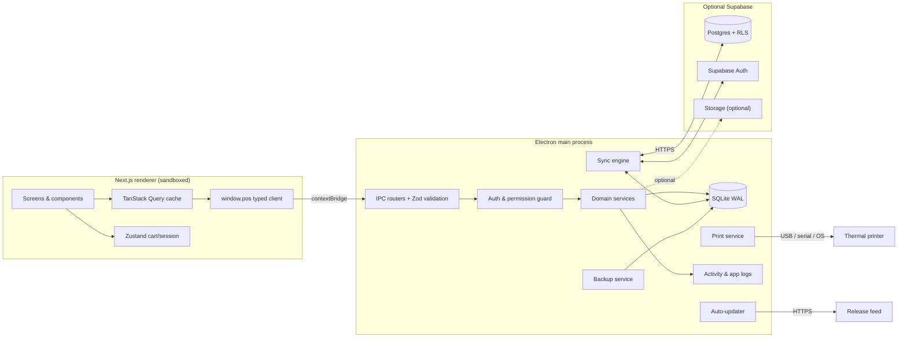

# OpenPOS — Product & Engineering Plan

**Status:** Draft v1.0  
**Target:** Indonesian corner store / warung / toko kelontong  
**Platform:** Offline-first desktop app (Electron + Next.js + Tailwind CSS)  
**Currency:** IDR (whole rupiah)  
**Primary locale:** Bahasa Indonesia (`id-ID`), timezone `Asia/Jakarta`  
**Companion document:** [`DATABASE_SCHEME.md`](./DATABASE_SCHEME.md)

---

## 1. Executive summary

OpenPOS is a single-store-first, offline-first point-of-sale and back-office desktop application for an Indonesian corner store. It must remain fully usable with no internet connection: sales, stock, credit, purchasing, shifts, printing, and reporting all run against a local SQLite database. Cloud sync to Supabase is optional and configured from the Settings screen by entering a project URL and anon key.

The product is deliberately deeper than a cash register. It includes:

- Multi-unit retail (bal → dus → pack → sachet/pcs) with accurate stock conversion.
- Tiered pricing (retail, wholesale by quantity, customer-group and customer-specific prices).
- Batch/expiry-aware inventory with FEFO picking and stock opname.
- Customer credit ledgers (kasbon), installment repayments, and credit limits.
- Supplier purchasing, cost-price history, accounts payable, and purchase returns.
- Shift/cash-drawer reconciliation, operational expenses, and cash movement audit.
- Role-based access, PIN login, approval overrides, and a full activity log.
- Double-entry accounting generated automatically from operational events.
- A statistics workspace covering sales, margin, inventory, credit, payables, cash, and accounting.
- Receipt printing over USB/Bluetooth thermal printers and digital receipt sharing.

### Product success criteria

1. A cashier can complete a normal sale in **under 20 seconds** using only the keyboard/barcode scanner.
2. The app works for **30+ days offline** without data loss or degraded checkout speed.
3. Every rupiah that enters or leaves the drawer is traceable to a transaction, shift, or expense.
4. Stock on hand always equals the sum of the immutable stock movement ledger.
5. Every posted journal entry balances; financial statements can be produced without spreadsheets.
6. An owner can connect Supabase, run one SQL script, and sync the full local dataset without manual table-by-table work.
7. A cashier cannot view profit, edit prices, delete transactions, or adjust stock without the correct permission.

---

## 2. Goals and non-goals

### Goals

- **Fast, keyboard-first checkout** that tolerates barcode scanners, touch screens, and low-end hardware.
- **Correct money and stock math** under real warung conditions: partial payments, returns, damaged goods, expired stock, and price changes.
- **Trustworthy books**: immutable ledgers, audit trails, and automatic double-entry journals.
- **Offline by default, cloud by choice**: no account or internet required to start selling.
- **Installable and maintainable** on Windows 10/11 first, with macOS/Linux builds as secondary targets.
- **Indonesian-first UX**: Bahasa Indonesia labels, IDR formatting, thermal receipt conventions, QRIS/e-wallet terminology.

### Non-goals for v1.0

- Multi-branch consolidation and inter-branch transfers (schema is multi-store-ready, UI is single-store).
- Online storefront, marketplace integration, or customer mobile app.
- Payroll, tax e-filing, e-Faktur, or certified fiscal printer integration.
- Dynamic QRIS payment gateway integration (v1 records QRIS as a manually confirmed payment method; gateway integration is a later add-on).
- Automated WhatsApp Cloud API messaging (v1 uses `wa.me` deep links and PDF sharing; Cloud API is an optional later module).
- Interest calculation, late fees, or automated credit scoring.
- Real-time multi-device collaboration on one local database. Multiple devices sync through Supabase; they do not share a LAN database.

### Explicit assumptions

- One installation serves one store. The database schema still carries `store_id` so a future multi-store edition and cloud dashboards work without migration pain.
- The owner is the primary administrator; at least one cashier account exists.
- The store may be non-PKP (no PPN) or PKP. Tax is configurable and disabled by default.
- Products may be sold by piece, sachet, pack, box, dus, bal, kilogram, gram, liter, or milliliter.
- A thermal receipt printer is optional. The app must still work with PDF/system printing.
- Internet is optional but, when available, may be metered or unstable. Sync must be resumable and non-blocking.

---

## 3. Personas and jobs to be done

### 3.1 Owner / shopkeeper ("Bu/Bapak")

- "I want to know today's sales, gross profit, and cash in the drawer without counting manually."
- "I want to know which products are running out, expiring, or not selling."
- "I want to know who still owes me money and how old the debt is."
- "I want to see whether supplier prices are rising."
- "I want staff to sell but not to change prices or delete transactions."
- "I want a backup and an optional cloud copy in case the laptop dies."

### 3.2 Cashier ("Kasir")

- "I want to find a product instantly by name or barcode."
- "I want to sell a bal or a sachet and have stock deducted correctly."
- "I want to hold a cart when the queue is busy and resume it later."
- "I want the change calculated automatically."
- "I want to print or WhatsApp the receipt quickly."
- "I want to close my shift and know if my cash is short or over."

### 3.3 Manager / trusted staff (optional role)

- Handles voids, returns, stock opname, and supplier receiving.
- Can approve a cashier's void or price override with their own PIN.
- Can view operational reports but not owner-only financial settings.

---

## 4. Product principles

1. **The local database is the source of truth.** Cloud sync is a replica and backup channel, never a dependency for checkout.
2. **Never delete financial history.** Voids, returns, and corrections create reversing records. Master data is soft-deleted.
3. **Append-only ledgers for stock, cash, credit, and accounting.** Cached balances are derived and repairable.
4. **One action, one transaction.** Completing a sale writes the sale, items, payments, stock movements, batch allocations, cash movement, credit charge, journal, and outbox entry atomically.
5. **Explain the math.** Every price, discount, tax, cost, and total must be inspectable in the UI and stored on the line.
6. **Keyboard-first, touch-friendly.** Cashiers should not need a mouse; touch targets stay large.
7. **Fail visibly, recover safely.** No silent sync failures, no partial sales, no hidden stock changes.
8. **Permission before convenience.** Sensitive actions require explicit permission and, where configured, a manager PIN.
9. **Indonesian reality first.** 58 mm receipts, round-number cash, QRIS, e-wallets, kasbon, tempo, and warung vocabulary.
10. **Boring, testable technology.** Prefer deterministic domain services and property-based tests over clever abstractions.

---

## 5. Scope and release slices

### v1.0 — "Complete shop"

Everything in this plan, delivered in vertical slices:

| Slice | Outcome |
|---|---|
| S0 Foundation | Electron shell, Next.js renderer, SQLite, migrations, IPC, design system, CI |
| S1 Identity & settings | PIN login, roles/permissions, store profile, receipt/tax/numbering settings |
| S2 Catalog & pricing | Products, variants, categories, multi-unit conversion, barcodes, price rules |
| S3 Inventory | Stock ledger, batches, expiry, low stock, receiving, opname, stock card |
| S4 Checkout | Search, cart, holds, split payments, change, receipts, shift binding |
| S5 Corrections | Voids, returns, approval overrides, audit log |
| S6 Cash & expenses | Shift open/close, cash in/out, expenses, X/Z reports, variance |
| S7 Credit | Customers, limits, credit sales, installments, aging, reminders |
| S8 Purchasing | Suppliers, POs, goods receipt, cost history, AP, supplier payments, returns |
| S9 Accounting | Chart of accounts, auto-posting, journals, periods, trial balance, P&L, balance sheet |
| S10 Statistics | Dashboard, sales/margin/inventory/credit/AP/cash reports, CSV/PDF export |
| S11 Printing & sharing | ESC/POS USB/Bluetooth, 58/80 mm templates, PDF, WhatsApp deep link |
| S12 Cloud sync | Supabase settings wizard, SQL script, auth, initial upload, incremental sync, conflicts |
| S13 Hardening | Backups, restore, performance, packaging, signing, updater, beta |

### Later (post-v1.0)

- Dynamic QRIS / payment gateway settlement and fees.
- WhatsApp Cloud API templates and delivery status.
- Multi-branch transfers and consolidated reporting.
- Customer-facing loyalty points and store credit wallet.
- Purchase order suggestions from sales velocity.
- Mobile stock-count companion.
- SQLCipher full-database encryption (if required by pilot customers).

---

## 6. Technology stack and decisions

| Concern | Decision | Rationale |
|---|---|---|
| Desktop shell | Electron 3x (current stable) | Mature native APIs for printing, serial, filesystem, updates |
| UI framework | Next.js (App Router) with `output: "export"` | Required by product direction; static export fits offline desktop |
| Styling | Tailwind CSS + shadcn/ui + Radix primitives | Fast, accessible, consistent design system |
| Language | TypeScript strict everywhere | Shared contracts and safer money/stock logic |
| Local database | SQLite via `better-sqlite3` | Synchronous, fast, reliable, single-writer process model |
| ORM / query layer | Drizzle ORM + hand-written SQL for reports | Typed schema, migrations, escape hatch for analytics |
| Validation | Zod schemas shared through IPC | Runtime validation at every process boundary |
| Server state | TanStack Query over typed IPC | Caching, invalidation, optimistic UI where safe |
| UI state | Zustand for cart/session/UI state | Small, predictable, no provider maze |
| Tables | TanStack Table | Virtualized product/report tables |
| Charts | Recharts | Sufficient for operational dashboards |
| Forms | React Hook Form + Zod | Consistent validation and error display |
| Dates | `date-fns` + `date-fns-tz` | Business-date handling in `Asia/Jakarta` |
| i18n | `i18next` / `react-i18next` | Indonesian default, English fallback |
| PDF | `pdfmake` or `@react-pdf/renderer` in main process | Receipts and reports without a browser print dialog |
| Thermal printing | `node-thermal-printer` + `serialport`; system print fallback | USB, network, and OS-paired Bluetooth support |
| Cloud | Supabase Postgres + Auth + optional Storage | User-requested; generous free tier; PostgREST fits sync |
| Packaging | `electron-builder` + `electron-updater` | NSIS, DMG, AppImage; signed auto-updates |
| Tests | Vitest, fast-check, Playwright Electron, pgTAP | Unit, property, E2E, and RLS coverage |
| Logging | `electron-log` with rotation | Local diagnostics without a mandatory cloud |
| CI | GitHub Actions (lint, typecheck, test, build) | Reproducible releases |

### Why static Next.js export, not a local Next server

Running a Next.js server inside Electron adds port conflicts, startup latency, an HTTP attack surface, and a second lifecycle to manage. A static export loaded through a custom `app://` protocol keeps the renderer fully local and lets the main process own all privileged work. Limitations (no server actions, no SSR, `next/image` unoptimized) are acceptable for a desktop app.

### Why SQLite in the main process

- One writer avoids multi-process locking complexity.
- `better-sqlite3` transactions are synchronous and fast.
- Renderer compromise cannot directly open the database.
- Backups are a single file (`VACUUM INTO`).
- SQLite is proven for embedded POS workloads and handles 100k+ sales comfortably with proper indexes.

---

## 7. System architecture



### Process responsibilities

**Main process**

- Owns SQLite, migrations, backups, and integrity checks.
- Exposes a narrow, typed IPC API. No generic `invoke(channel, ...)` bridge.
- Enforces permissions again (never trust the renderer).
- Runs domain services inside database transactions.
- Manages shift/session state, printing, file dialogs, and auto-update.
- Runs the optional sync scheduler and conflict resolution.
- Stores secrets with Electron `safeStorage` (OS keychain-backed where available).

**Preload**

- `contextBridge.exposeInMainWorld("pos", ...)` with namespaced methods only.
- No Node globals, no `ipcRenderer`, no filesystem access.
- Each method maps to an allow-listed channel and validates arguments with Zod before sending.

**Renderer**

- Pure UI and local UI state.
- Fetches through TanStack Query; never assumes a mutation succeeded until the main process confirms.
- Displays sync status, printer status, and permission-denied states clearly.
- Cannot read the SQLite file, environment variables, or Supabase tokens.

### IPC contract shape

```ts
// packages/shared/src/ipc.ts
export const Ipc = {
  auth: {
    login: "auth.login",
    logout: "auth.logout",
    current: "auth.current",
    unlock: "auth.unlock",
  },
  sales: {
    searchProducts: "sales.searchProducts",
    quote: "sales.quote",
    complete: "sales.complete",
    hold: "sales.hold",
    resume: "sales.resume",
    void: "sales.void",
    createReturn: "sales.createReturn",
  },
  // ...one namespace per domain
} as const;
```

Every request returns a discriminated result:

```ts
type Ok<T> = { ok: true; data: T };
type Err = { ok: false; error: { code: string; message: string; details?: unknown } };
```

Domain error codes are stable (`PERMISSION_DENIED`, `INSUFFICIENT_STOCK`, `CREDIT_LIMIT_EXCEEDED`, `SHIFT_REQUIRED`, `PERIOD_CLOSED`, `SYNC_OFFLINE`, etc.) so the UI can translate them.

---

## 8. Repository layout

```text
openpos/
├─ apps/
│  ├─ desktop/                 # Electron main + preload + builder config
│  │  ├─ src/main/
│  │  │  ├─ index.ts
│  │  │  ├─ windows.ts
│  │  │  ├─ ipc/               # one router per domain
│  │  │  ├─ services/          # sales, inventory, credit, accounting...
│  │  │  ├─ sync/
│  │  │  ├─ printing/
│  │  │  ├─ backup/
│  │  │  └─ security/
│  │  ├─ src/preload/
│  │  └─ electron-builder.yml
│  └─ web/                     # Next.js static export
│     ├─ app/
│     ├─ components/
│     ├─ features/             # checkout, products, reports, settings...
│     ├─ lib/
│     └─ styles/
├─ packages/
│  ├─ core/                    # pure domain logic (pricing, cart math, allocation)
│  ├─ db/                      # Drizzle schema, migrations, repositories
│  ├─ shared/                  # Zod contracts, types, error codes, i18n keys
│  └─ ui/                      # design system
├─ db/
│  └─ sqlite/0001_init.sql     # canonical local schema
├─ supabase/
│  ├─ migrations/0001_init.sql # cloud schema, RLS, change feed
│  └─ seed.sql                 # optional reference data
├─ docs/
├─ tests/
│  ├─ unit/
│  ├─ integration/
│  ├─ e2e/
│  └─ supabase/
├─ PLAN.md
├─ DATABASE_SCHEME.md
└─ package.json
```

### Architectural rules

- `packages/core` has **no** Electron, database, or React imports. It is deterministic and unit-tested.
- `packages/db` owns SQL and transactions; services orchestrate repositories.
- Renderer code may import types and Zod schemas, never main-process modules.
- Reports may use raw SQL views/materialized rollups; they must not duplicate domain rules.
- Every mutation that touches money or stock goes through a domain service, not an ad-hoc IPC handler.

---

## 9. Security model

### Desktop hardening

- `contextIsolation: true`, `nodeIntegration: false`, `sandbox: true`, `webSecurity: true`.
- Strict CSP: no remote scripts, no inline eval, no arbitrary navigation.
- Custom `app://` protocol serves only bundled assets; path traversal blocked.
- `will-navigate` and `setWindowOpenHandler` deny external navigation; allow-listed links open in the system browser.
- Single-instance lock prevents two processes writing SQLite.
- IPC arguments validated with Zod; unknown channels rejected; sender frame checked.
- Database file permissions restricted to the OS user; optional SQLCipher later.
- Secrets (Supabase refresh token, optional SMTP/WhatsApp tokens) encrypted with `safeStorage`; never written to logs or synced.
- PINs hashed with Argon2id (per-user salt); rate-limited with exponential backoff; no plaintext recovery.
- Idle auto-lock (configurable, default 10 minutes); sensitive actions can require re-auth/manager PIN.
- Activity log captures actor, action, entity, before/after JSON, and timestamp for sensitive changes.

### Supabase hardening

- Only the **anon key** is configured in the app. The `service_role` key is never shipped or accepted.
- Supabase Auth email/password identifies the owner/device session; refresh tokens are encrypted locally.
- Every table has RLS enabled and store-scoped policies via `is_store_member(store_id)`.
- Financial/stock ledgers are append-only at the policy level (insert/select, no update/delete).
- The initial schema is created by the user running the provided SQL in the Supabase SQL editor; the app cannot execute arbitrary DDL.
- `claim_store()` (security-definer RPC) creates the store and owner membership exactly once for the authenticated user.
- Optional Storage bucket policies restrict product images to store members.

### Privacy

- Customer phone numbers are personal data. Provide export and delete/anonymize flows.
- Cloud sync is opt-in. Disconnecting preserves local data and stops all uploads.
- No telemetry by default. Any crash reporting is opt-in and documented.
- Backups are local by default; optional cloud backup is explicit and encrypted.

---

## 10. Money, quantity, and time conventions

| Concept | Storage | Rule |
|---|---|---|
| Money totals | `INTEGER` rupiah | No cents. JavaScript `number` is safe below 9e15; validate against `MAX_SAFE_INTEGER` |
| Unit cost / average cost | `REAL` rupiah, 4 dp | Needed because a sachet from a bal can cost Rp 2,083.3333 |
| Quantity | `REAL`, 3 dp | Supports kg/liter; pieces remain integers in practice |
| Conversion factor | `REAL`, 4 dp | `qty_base = qty × factor_to_base` |
| Percent | `REAL`, 2 dp | Store 11.00, not 0.11 |
| IDs | UUIDv7 text | Time-sortable, generated locally, sync-safe |
| Timestamps | ISO-8601 UTC text (`...Z`) | SQLite `TEXT`; Postgres `timestamptz` |
| Business date | `YYYY-MM-DD` local date | Captured once at transaction time; immutable |
| Boolean | SQLite `INTEGER 0/1`; Postgres `boolean` | Never store `"true"` strings |
| JSON | SQLite `TEXT` + `json_valid`; Postgres `jsonb` | Attributes, payloads, settings |

**Rounding policy**

- Line gross = `round(qty × unit_price)` to whole rupiah (half-up).
- Line discount = `round(gross × discount_percent / 100)` or a fixed amount.
- Line total = gross − discount + tax.
- Order totals are sums of rounded lines.
- Manual order discount is allocated proportionally to lines for COGS/tax reporting.
- Cash rounding (`rounding_total`) applies only to the final grand total, using a configurable increment (default Rp 100; can be 0).
- Change = cash tendered − applied cash amount. Change is never negative; overpayment without cash is rejected.
- Journal amounts are whole rupiah; inventory valuation rounds at report time.

**Timezone policy**

- The OS may be in any timezone. The app computes `business_date` in the store timezone (`Asia/Jakarta` by default).
- Reports group by `business_date`, not UTC timestamps.
- A shift crossing midnight keeps one `business_date` for its opening; sales carry their own business date.
- Clock changes are logged. If the system clock moves backwards, the app warns before completing transactions.

---

## 11. Feature specifications

### 11.1 Cashier and sales transactions

#### Product search and item entry

- Global search box focused by default (`F2`).
- Searches product name, SKU, variant name, and barcode; prefix and substring matching.
- Barcode scanner input is treated as keyboard input; exact barcode match adds the item immediately.
- Search results show name, variant, available stock in the selected unit, retail price, and unit selector.
- Debounced at ~80 ms; results keyboard-navigable (↑/↓/Enter); no pagination blocking for the first 20 results.
- Out-of-stock items are visible but blocked from sale unless `allow_negative_stock` is enabled.
- Weighted items open a quantity keypad with 3-decimal support and a "tare" note field.
- Optional quick keys: `F3` quantity, `F4` discount, `F5` price check, `Delete` remove line.

#### Cart behavior

- One active cart per cashier session. Held carts are separate records.
- Line identity = product + variant + unit + price rule. Adding the same combination merges quantities unless a manual price override differs.
- Unit selector changes price and conversion; switching units recalculates the line and stock preview.
- Stock is validated at completion, not only when added, to avoid stale reservations.
- Cart totals update locally from a shared pricing function; the main process re-quotes authoritatively before payment.
- Manual line discount (percent or amount) is permission-gated (`sales.discount`).
- Manual price override is permission-gated (`sales.price_override`) and logged with the original price.
- Customer selection changes the applicable price tier and enables credit payment.
- Order-level note and per-line note are supported.

#### Hold / resume

- `F8` holds the cart with an optional label (customer name or queue note).
- Held carts store items, customer, notes, and quoted prices; they do **not** deduct stock or create payments.
- Hold list shows age, cashier, item count, and total; searchable by label.
- Resume restores the cart and re-quotes prices (configurable: keep held prices or refresh).
- Holds expire after N days (default 7) and are archived with an audit entry; they are never silently deleted.
- A cashier can only resume their own holds unless `sales.resume_any` is granted.

#### Payments

Supported methods:

- **Cash** with tendered amount and automatic change; quick-cash buttons (exact, 50k, 100k, round up).
- **Bank transfer** with optional reference number and bank label.
- **E-wallet** (GoPay, OVO, DANA, ShopeePay, etc.) with provider and reference.
- **QRIS** with static merchant QR display/print; cashier confirms settlement manually in v1.
- **Split payment** across methods (for example Rp 50k cash + Rp 100k QRIS).
- **Credit (kasbon)** for eligible customers; unpaid remainder becomes a receivable.

Rules:

- `sum(payments.amount) + due_total = grand_total`.
- Cash `tendered_amount` may exceed the applied amount; `change_amount` records the difference.
- Non-cash payments cannot overpay.
- A sale cannot complete with a negative total.
- QRIS/e-wallet status is `settled` on manual confirmation; a future gateway can set `pending` and reconcile later.
- Payment references are optional but recommended and searchable.
- Duplicate submission is prevented by a client idempotency key and a disabled pay button until the result returns.

#### Receipt

- Receipt number generated per device/store/day, e.g. `INV-K1-20261121-0007`.
- 58 mm and 80 mm layouts; Indonesian labels; store header, address, phone.
- Shows line items, unit, qty, price, discount, subtotal, tax (if enabled), rounding, total, payments, change, cashier, shift, timestamp, receipt number.
- Footer configurable (thank-you message, return policy, QRIS note).
- Return/void receipts are clearly marked and reference the original receipt.
- Print actions: thermal, system print/PDF, share PDF, WhatsApp text/PDF.

#### Voids

- Voiding is allowed only for completed sales that are not already fully returned.
- Requires `sales.void` permission and a **mandatory reason** (preset list + free text).
- A cashier without permission can request a void; a manager/owner enters their PIN to approve.
- Void reverses: stock movements, batch allocations, cash movement, credit charge, journal (reversal entry), and payment status.
- The original sale and payments are never deleted; status becomes `voided` with `voided_at`, `voided_by`, and reason.
- Voided sales are excluded from revenue and included in exception reports.
- Cross-shift voids require `sales.void_cross_shift` and are highlighted in the audit report.

#### Returns

- Partial or full return against a completed sale, line by line, with quantity limits (sold minus already returned).
- Mandatory reason code: damaged, expired, wrong item, customer changed mind, other.
- Refund methods: original method, cash, bank transfer, e-wallet, QRIS.
- Restock toggle per line; damaged/expired items go to a quarantine/waste movement instead of sellable stock.
- Return creates a `sale_returns` record, stock movements, cash movement (if cash), credit adjustment (if credit sale), and a reversing journal.
- Return receipt is printable/shareable.
- Returns are permission-gated (`sales.return`); approval is logged.
- Return window is configurable (default: same business day, owner can override).

### 11.2 Product management and tiered pricing

#### Product identity

- Each product has a name, SKU, category, base unit, brand, optional description/image, and active flag.
- Variants represent flavors, sizes, colors, or pack types. A product may have zero or more variants.
- A variant is a separate stock-keeping unit, but shares the product's unit hierarchy and category.
- Barcodes can be attached to a product, variant, or specific unit (for example a bal barcode vs a sachet barcode).

#### Multi-unit conversion

Example:

```text
1 bal   = 12 dus
1 dus   = 24 pcs
=> 1 bal = 288 pcs (base unit = pcs)

Product units:
  pcs   factor_to_base = 1     selling_price = 3,000
  dus   factor_to_base = 24    selling_price = 65,000
  bal   factor_to_base = 288   selling_price = 720,000
```

Rules:

- `factor_to_base` is authoritative. `factor_to_parent` exists only for display/entry convenience.
- Selling one dus deducts 24 base units; selling 0.25 kg deducts 0.25 base units.
- Unit price is per selected unit, not per base unit.
- The unit hierarchy must be acyclic; the app validates parent/child consistency when saving.
- Deactivating a unit does not break historical sales (snapshots keep unit + factor).
- Receiving can use any purchase unit; stock is added in base units.
- A unit may have its own barcode and selling price. If no price is set, fallback is `product.retail_price × factor_to_base`.
- "Base unit" is the smallest stock-keeping unit the store counts (pcs, gram, ml). It cannot be deleted while referenced.

#### Price resolution

When a line is quoted, resolve in this order (first match wins, deterministic):

1. **Customer-specific price rule** for the product/variant/unit, active now.
2. **Customer-group price rule** for the product/variant/unit, active now.
3. **Quantity-based wholesale rule** for the product/variant/unit where `qty >= min_qty`; the highest qualifying `min_qty` wins; ties break by highest `priority`, then lowest price.
4. **Unit-specific selling price** on `product_units`.
5. **Variant retail price override**.
6. **Product retail price × conversion factor**.

Additional rules:

- A rule can be a fixed `price` or a `discount_percent` off the resolved base price. Fixed price wins if both are set.
- Rules can target a category (applies to all products in it) but product/variant/unit rules take precedence.
- `starts_at`/`ends_at` are inclusive/exclusive respectively, evaluated in store time.
- `priority` breaks ties among equally specific rules; higher wins.
- The resolved `price_rule_id` and `price_source` are stored on the sale line for audit and reporting.
- Price changes never rewrite historical sale lines.
- Bulk price update is permission-gated and logged; it supports percentage, fixed delta, or setting a new retail price, with a preview.

#### Categories and variants

- Categories support one level of nesting (parent/child) for shelf grouping.
- Category deletion is soft; products must be reassigned or remain uncategorized.
- Variant attributes are stored as JSON (for example `{"size":"1L","flavor":"original"}`) and rendered as chips.
- SKU generation is optional; manual SKU/barcode entry is always supported.
- CSV import/export for products, units, barcodes, and opening stock; import validates and reports row-level errors.

#### Customer groups

- Default groups: Retail, Grosir (wholesale), Langganan (regular/VIP).
- A group can define a default discount percentage and a default price tier.
- A customer belongs to at most one group.
- Customer-specific rules override group rules.

### 11.3 Inventory and stock management

#### Ledger model

- `stock_levels` is a cached balance per product/variant for fast reads.
- `stock_movements` is the immutable source of truth: signed `qty_delta` in base units.
- Every stock-changing event writes one or more movements and updates the cached level in the same transaction.
- Movement types: opening balance, purchase receipt, purchase return, sale, sale return, adjustment, opname, waste/expiry, transfer in/out (future).
- A movement stores both the entered quantity/unit and the base quantity/factor, for audit.
- Sale movements snapshot unit cost for COGS and margin reporting.

#### Batches and expiry (FEFO)

- Receiving with an expiry date creates a `stock_batches` row with `qty_remaining`.
- Sales allocate from batches by **First Expired, First Out** when expiry is present; otherwise by received date.
- A sale line can consume multiple batches; `sale_item_batches` records the split.
- Expiry alerts show batches expiring within 30/60/90 days and already-expired batches.
- Expired stock is blocked from sale by default; an owner can force-sell with a reason (logged).
- Waste/expiry write-off creates a negative movement and optionally a journal to inventory adjustment.
- COGS uses moving weighted average cost, not the specific batch cost, to keep accounting consistent. Batch costs remain available for analysis.

#### Low-stock alerts

- Each product has `min_stock_qty` in base units; a per-store override can be added later.
- Low stock = `qty_on_hand <= min_stock_qty` and product is active and stock-tracked.
- Dashboard badge, product list filter, and a "restock suggestions" report.
- Alerts are computed, not stored, so they cannot drift.
- Optional daily summary notification at opening.

#### Receiving goods

- Goods receipt can be created from a purchase order or ad hoc from a supplier invoice.
- Lines use purchase units (bal/dus/pcs), unit cost, discount, expiry, and batch number.
- Posting a receipt:
  1. Validates quantities and supplier.
  2. Creates `purchases` and `purchase_items`.
  3. Creates batches and positive stock movements.
  4. Updates moving average cost and last cost.
  5. Writes the supplier payable and journal (inventory/AP or cash).
  6. Enqueues sync changes.
- Cost history is queryable per product/supplier; price increases are highlighted.
- Receiving is atomic: a failure leaves no partial stock or payable.

#### Stock opname (physical count)

- Session header with scope: all products, category, or filtered list.
- Count sheet shows system quantity, counted quantity, difference, and unit cost.
- Supports barcode scanning and blind count mode (hide system qty).
- Draft counts are saved locally; multiple sessions are allowed but only one active per scope.
- Finalizing:
  1. Requires `inventory.opname` and a reason for material variances.
  2. Creates adjustment movements for every difference.
  3. Updates stock levels and average cost policy (default: keep current average).
  4. Posts an inventory adjustment journal.
  5. Writes an activity log with before/after quantities.
- Variance report by product/category/value; supports recount.
- Finalized sessions are immutable; corrections require a new adjustment with a reason.

#### Stock card and valuation

- Stock card per product/variant: date, reference, in/out, balance, unit cost.
- Valuation at moving average and at last cost; total inventory value on the dashboard.
- Dead stock = no sales in 30/60/90 days with stock on hand.
- Slow movers and ABC analysis by revenue/margin contribution.

### 11.4 Credit ledger and customer management

#### Customer record

- Name, phone (normalized for search), address, group, notes, active flag.
- Credit limit (Rp) and term days (default 30).
- Credit balance is cached but always reconcilable from the ledger.
- Duplicate phone detection with a warning, not a hard block (family members may share a number).
- Customer statement export (PDF/CSV) and WhatsApp reminder link.

#### Credit sale

- Credit is available only when a customer is selected and `credit.grant` is permitted.
- Available credit = `credit_limit − credit_balance`.
- The unpaid remainder (`due_total`) must be ≤ available credit; otherwise the sale is blocked with a clear message.
- On completion, a positive `credit_ledger` charge is created with `sale_id`, due date, and balance after.
- The sale's `payment_status` becomes `unpaid` or `partial`.
- Credit sales still deduct stock and recognize revenue; the debit is accounts receivable.

#### Repayments and installments

- A repayment records amount, method, date, receiver, shift, and reference.
- Cash repayments increase the shift's expected cash and create a cash movement.
- Non-cash repayments go to bank/e-wallet clearing accounts.
- The payment is allocated to the oldest unpaid charges by default; the cashier can choose specific invoices.
- Each allocation writes a negative ledger entry referencing the payment and sale, and updates the sale's `due_total`.
- Partial payments are fully supported; overpayment is rejected (or applied as an advance only if the feature is enabled later).
- Payment receipt is printable/shareable.
- Voiding a repayment requires permission and a reason; it restores the receivable.

#### Aging and limits

- Aging buckets: current, 1–30, 31–60, 61–90, 90+ days overdue.
- Dashboard shows total receivables, overdue amount, and top debtors.
- Credit limit changes are permission-gated and audited.
- A customer with overdue invoices can be blocked from new credit (configurable).
- Statements show invoice date, due date, original amount, paid, remaining, and age.

### 11.5 Supplier and purchasing management

#### Supplier record

- Name, code, contact person, phone, email, address, payment terms (days), notes, active flag.
- Multiple suppliers per product; one preferred supplier.
- Supplier SKU and last quoted cost per product.

#### Purchase orders

- Optional but recommended for restocking.
- Draft → ordered → partially received → received → cancelled.
- Lines with product, unit, quantity, expected cost, and expected date.
- Receiving can be partial; received quantities update the PO.
- PO printing/PDF and WhatsApp sharing.

#### Goods receipt and cost history

- Purchase invoice fields: supplier invoice number, invoice date, due date, discounts, tax, shipping.
- Each line snapshots unit, factor, base quantity, unit cost, and base unit cost.
- Receiving updates `product_suppliers.last_cost` and `products.cost_price`; a full history remains in purchase items.
- Cost trend report per product/supplier with percentage change and last purchase date.
- Purchase returns for damaged/short-delivered goods; reduce stock and payable.

#### Accounts payable

- Posting a purchase creates a payable with due date from supplier terms.
- `due_total = grand_total − paid_total − returns`.
- Payments can be cash (from drawer), bank transfer, or e-wallet; cash payments create a cash movement.
- AP aging: current, 1–30, 31–60, 61–90, 90+.
- Payment reminders on the dashboard for invoices due within 7 days.
- Supplier payment history and statement export.
- Voiding a posted purchase requires `purchases.void`, reverses stock (only if stock is still available), reverses AP, and posts a reversing journal.

### 11.6 Daily cash and shift management

#### Opening a shift

- Cashier selects/creates a shift for the register/device.
- Opening cash float is entered with denomination breakdown (optional but recommended).
- Only one open shift per device/register at a time.
- Sales cannot complete without an open shift unless the owner enables "allow sales without shift" (not recommended).
- Opening cash posts a journal (Dr Cash, Cr Owner Equity/Opening Balance) only if the store uses accounting from day one.

#### During the shift

- Every cash-affecting event creates a `cash_movements` row:
  - cash sale applied amount,
  - cash refund,
  - cash credit repayment,
  - cash supplier payment,
  - expense paid from drawer,
  - cash in (owner deposit),
  - cash out (owner drawing, bank deposit).
- Non-cash payments do not affect drawer cash but do affect bank/e-wallet clearing accounts.
- Cash in/out requires permission and a reason.
- The shift screen shows expected cash live.

#### Closing a shift

- Expected cash = opening cash + sum(cash movements).
- Cashier enters counted cash, optionally by denomination.
- Difference = counted − expected; positive is over, negative is short.
- Closing requires `shifts.close`; a large variance can require manager approval.
- Closing locks the shift; no new sales or cash movements can reference it.
- Z-report prints: sales by method, discounts, returns, voids, expenses, credit payments, expected vs counted, variance.
- Variance posts to a Cash Over/Short account.
- Cross-shift corrections are allowed only through a new adjustment with audit, never by editing a closed shift.

#### Operational expenses

- Categories: plastic bags, electricity tokens, staff meals, transport, cleaning, rent, internet, miscellaneous.
- Expense fields: date, category, amount, paid from (drawer/bank/e-wallet), description, reference, receipt photo optional.
- Expense from drawer reduces expected cash and posts an expense journal.
- Expenses are permission-gated (`expenses.create`) and voidable with a reason.
- Expense report by category/day/month and export.

### 11.7 User management and access control

#### Users and roles

- Users log in with username + PIN (4–8 digits) or password (owner option).
- Roles: Owner (system), Manager (optional), Cashier (system), plus custom roles.
- One role per user; permissions are additive through the role.
- Owner role cannot be deleted or have critical permissions removed.
- Users can be deactivated but never deleted if they have transactions.
- PIN reset by owner; forced PIN change on next login.
- Login attempts are rate-limited and logged.
- Idle lock and manual lock; unlocking requires the user's PIN.

#### Permission catalog (v1)

| Group | Permission | Owner | Cashier |
|---|---|---|---|
| Sales | `sales.create` | ✓ | ✓ |
| Sales | `sales.hold` / `sales.resume_any` | ✓ | ✓ / ✗ |
| Sales | `sales.discount` | ✓ | ✗ |
| Sales | `sales.price_override` | ✓ | ✗ |
| Sales | `sales.void` / `sales.void_cross_shift` | ✓ | ✗ |
| Sales | `sales.return` | ✓ | ✗ |
| Products | `products.view` | ✓ | ✓ |
| Products | `products.create` / `products.edit` | ✓ | ✗ |
| Products | `products.edit_price` | ✓ | ✗ |
| Products | `products.delete` | ✓ | ✗ |
| Inventory | `inventory.view` | ✓ | ✓ |
| Inventory | `inventory.adjust` | ✓ | ✗ |
| Inventory | `inventory.opname` | ✓ | ✗ |
| Inventory | `inventory.receive` | ✓ | ✗ |
| Purchasing | `purchases.view` / `purchases.create` | ✓ | ✗ |
| Purchasing | `purchases.pay` / `purchases.void` | ✓ | ✗ |
| Customers | `customers.view` / `customers.create` | ✓ | ✓ |
| Customers | `customers.edit` | ✓ | ✗ |
| Credit | `credit.grant` / `credit.limit` | ✓ | ✗ |
| Credit | `credit.payment` | ✓ | ✓ |
| Expenses | `expenses.create` | ✓ | ✗ |
| Shifts | `shifts.open` / `shifts.close` | ✓ | ✓ |
| Shifts | `cash.in_out` | ✓ | ✗ |
| Reports | `reports.sales` | ✓ | ✓ (own shift only) |
| Reports | `reports.profit` | ✓ | ✗ |
| Reports | `reports.inventory` | ✓ | ✗ |
| Reports | `reports.finance` | ✓ | ✗ |
| Accounting | `accounting.view` / `accounting.post` | ✓ | ✗ |
| Accounting | `accounting.close_period` | ✓ | ✗ |
| Admin | `users.manage` / `settings.manage` | ✓ | ✗ |
| Admin | `sync.manage` / `backup.manage` | ✓ | ✗ |
| Admin | `audit.view` | ✓ | ✗ |

#### Approval overrides

- Sensitive actions can be configured to require a second user's PIN: void, return after window, large discount, price override, stock adjustment above a threshold, credit limit increase.
- The approver must have the required permission.
- Both actor and approver are recorded in `activity_logs` and on the transaction record.
- Approval sessions expire after 60 seconds.

#### Activity log

- Append-only; no UI edit/delete.
- Captures: actor, action, entity type/id, before/after (redacted for secrets), reason, device, timestamp.
- Required events: login success/failure, logout, sale void, return, price change, stock adjustment, opname finalize, credit limit change, credit payment void, purchase void, settings change, user/role change, sync conflict resolution, period close, backup/restore.
- Searchable by user, action, entity, and date; export to CSV.

### 11.8 Offline-first and optional Supabase sync

#### Local-first guarantees

- All writes go to SQLite first and return to the UI immediately.
- Sync never blocks checkout, printing, or shift close.
- The app starts and sells with no network and no Supabase account.
- Product images, receipts, and backups live in the app data directory, not in browser storage.
- The sync indicator has explicit states: `offline`, `idle`, `syncing`, `error`, `conflict`, `disabled`.

#### Supabase configuration flow (Settings → Cloud Sync)

1. Toggle **Enable cloud sync**.
2. Enter **Project URL** and **anon public key**; both are validated syntactically.
3. Open the provided SQL file (`supabase/migrations/0001_init.sql`), copy it, and run it in the Supabase SQL Editor. The UI includes a copy button and a short checklist.
4. **Test connection** calls the REST endpoint and verifies required tables/RPCs exist.
5. **Sign in / create account** with Supabase Auth (email + password). The refresh token is stored encrypted.
6. **Claim store** calls `claim_store(store_id, name, address)`; this creates the store and owner membership if unclaimed. If another account already owns it, the app explains how to transfer ownership via the dashboard.
7. **Initial upload** shows per-table progress, is resumable, and verifies row counts. It runs in foreign-key-safe order.
8. Enable automatic sync: push after writes (debounced) and on a 30–60 s timer; pull every 60 s and on focus.
9. **Sync now** is always available; **Disconnect** stops sync and clears tokens but keeps local data.
10. A diagnostics panel shows last push/pull, outbox backlog, errors, and conflict count.

#### Outbox and change feed

- Each domain mutation writes a row to `sync_outbox` in the same SQLite transaction.
- Outbox payloads are full row snapshots plus `base_updated_at` for conflict detection.
- The pusher sends batches (default 100 rows) in dependency order; failures retry with exponential backoff.
- The puller reads `change_feed` by monotonic `server_seq`, applies rows in a transaction, and stores the cursor.
- Local applies from cloud do **not** re-enqueue to the outbox.
- Stock levels and customer/supplier balances are treated as caches: movements and ledger entries are authoritative.
- Secrets, device-specific settings, PIN hashes, and printer addresses never sync.

#### Conflict policy

- **Immutable ledgers** (stock movements, journal lines, credit ledger, void records, activity logs): append-only, no conflicts by construction.
- **Transactional headers** (sales, purchases, payments, shifts, returns): status transitions are last-write-wins by `updated_at`, but amounts are immutable after posting.
- **Master data** (products, prices, customers, suppliers, settings): last-write-wins by `updated_at`; if both sides changed since the last pull, a conflict is logged with both versions.
- Conflicts are visible in Settings → Sync → Conflicts, with a field-level diff and "keep local / keep cloud" actions.
- Price conflicts default to "keep local" only if the local user has `products.edit_price`; otherwise cloud wins and the local change is reported.
- Sync never auto-merges financial amounts.

#### Initial migration to Supabase

The app performs a full upload, not a raw SQLite file copy:

1. Run the cloud schema SQL once.
2. Authenticate and claim the store.
3. Upload reference tables first: roles, permissions, users (without PIN hashes), categories, units, products, variants, units, barcodes, customer groups, price rules, suppliers, customers, accounts, mappings, periods, settings.
4. Upload transactional tables in chronological order: shifts, sales, sale items, payments, stock movements, batches, purchases, credit ledger, journals.
5. Upload sync metadata last.
6. Verify counts and spot-check totals (sales grand total, stock on hand, AR/AP balances).
7. Mark `initial_upload_completed` in `sync_state` and enable incremental sync.

The SQL script is idempotent for schema creation and safe to re-run; it does not drop data.

#### Multi-device numbering

- Offline devices cannot coordinate receipt numbers centrally.
- Each device gets a short code (`K1`, `K2`) stored in settings.
- Receipt numbers include the device code: `INV-K1-20261121-0007`.
- Sequence rows are device-local; the cloud stores the final receipt number as text.
- A conflict on the same receipt number is practically impossible; if it occurs, the sync conflict panel flags it.

### 11.9 Receipt printing and sharing

#### Printer support

- **USB thermal**: direct ESC/POS via `node-thermal-printer` or OS driver; fallback to system print.
- **Bluetooth thermal**: pair in the OS first, then use the assigned serial/COM port. The app documents Windows/macOS pairing steps.
- **Network thermal**: IP:9100.
- **System printers**: Electron `webContents.print` with a print-friendly receipt HTML template.
- Printer profiles: name, connection type, address, paper width, characters per line, default flag.
- Test print and cash-drawer kick (optional) from settings.
- Print failures are surfaced with retry; the sale is never rolled back because printing failed.
- A print job log records attempts and errors for support.

#### Receipt templates

- 58 mm (32 chars) and 80 mm (48 chars), monospace alignment.
- Store logo optional (ESC/POS raster or text fallback).
- Indonesian labels: `No. Nota`, `Kasir`, `Shift`, `Total`, `Tunai`, `Kembali`, `Hutang`, `Terima kasih`.
- QRIS static QR, barcode/QR of receipt number, or WhatsApp QR optional.
- Return receipts and shift Z-reports use separate templates.
- PDF receipts use the same data with a larger layout.

#### WhatsApp sharing

- v1: `https://wa.me/<phone>?text=<encoded receipt summary>` opens the system browser/WhatsApp.
- PDF can be saved and shared through the OS share sheet.
- Optional later: Supabase Edge Function + WhatsApp Cloud API with approved templates; requires internet and opt-in.
- Sharing is logged (sale, channel, destination, timestamp, success/failure) in the activity log.

### 11.10 Accounting

#### Model

- Double-entry general ledger, store-scoped chart of accounts.
- Journals are generated automatically from operational events; manual journals are allowed for the owner with `accounting.post`.
- Posting is idempotent per source event (`source_type` + `source_id` unique).
- Every entry must balance: `sum(debit) = sum(credit)`.
- Journal lines are immutable; corrections are reversing entries.
- Accounting periods (monthly) can be closed to prevent back-posting.
- The app supports accrual accounting for sales/purchases and cash-basis visibility through cash reports.

#### Standard chart of accounts (seed)

| Code | Account | Type | Normal |
|---|---|---|---|
| 1000 | Cash on Hand | Asset | Debit |
| 1010 | Bank | Asset | Debit |
| 1020 | E-wallet Clearing | Asset | Debit |
| 1030 | QRIS Clearing | Asset | Debit |
| 1100 | Accounts Receivable | Asset | Debit |
| 1200 | Inventory | Asset | Debit |
| 1300 | Prepaid Expenses | Asset | Debit |
| 1500 | Equipment | Asset | Debit |
| 2000 | Accounts Payable | Liability | Credit |
| 2100 | Tax Payable (PPN) | Liability | Credit |
| 3000 | Owner Equity | Equity | Credit |
| 3100 | Retained Earnings | Equity | Credit |
| 3200 | Owner Drawings | Equity | Debit |
| 4000 | Sales Revenue | Revenue | Credit |
| 4100 | Sales Returns | Revenue (contra) | Debit |
| 4200 | Sales Discounts | Revenue (contra) | Debit |
| 5000 | Cost of Goods Sold | Expense | Debit |
| 5100 | Inventory Adjustments / Shrinkage | Expense | Debit |
| 6000 | Operating Expenses | Expense | Debit |
| 6010 | Supplies & Packaging | Expense | Debit |
| 6020 | Utilities | Expense | Debit |
| 6030 | Rent | Expense | Debit |
| 6040 | Staff Meals & Allowances | Expense | Debit |
| 6050 | Transport | Expense | Debit |
| 6900 | Cash Over / Short | Expense | Debit |
| 7000 | Other Income | Revenue | Credit |
| 8000 | Other Expense | Expense | Debit |

`account_mappings` maps event roles to accounts: `cash_drawer`, `bank`, `ewallet_clearing`, `qris_clearing`, `accounts_receivable`, `inventory`, `accounts_payable`, `sales_revenue`, `sales_returns`, `sales_discount`, `cogs`, `inventory_adjustment`, `cash_over_short`, `tax_output`, `tax_input`, `rounding`, `owner_equity`, `owner_drawings`, `opening_balance_equity`.

#### Journal templates

**Cash sale (Rp 100,000, cost Rp 70,000)**

| Account | Debit | Credit |
|---|---:|---:|
| Cash on Hand | 100,000 | |
| Sales Revenue | | 100,000 |
| Cost of Goods Sold | 70,000 | |
| Inventory | | 70,000 |

**Credit sale (Rp 50,000, cost Rp 35,000)**

| Account | Debit | Credit |
|---|---:|---:|
| Accounts Receivable | 50,000 | |
| Sales Revenue | | 50,000 |
| Cost of Goods Sold | 35,000 | |
| Inventory | | 35,000 |

**Split payment (Rp 30,000 cash + Rp 20,000 QRIS)**

| Account | Debit | Credit |
|---|---:|---:|
| Cash on Hand | 30,000 | |
| QRIS Clearing | 20,000 | |
| Sales Revenue | | 50,000 |

**Sale return (refund cash Rp 10,000, cost Rp 7,000, restocked)**

| Account | Debit | Credit |
|---|---:|---:|
| Sales Returns | 10,000 | |
| Cash on Hand | | 10,000 |
| Inventory | 7,000 | |
| Cost of Goods Sold | | 7,000 |

**Purchase on credit (Rp 200,000, no tax)**

| Account | Debit | Credit |
|---|---:|---:|
| Inventory | 200,000 | |
| Accounts Payable | | 200,000 |

**Supplier payment**

| Account | Debit | Credit |
|---|---:|---:|
| Accounts Payable | 200,000 | |
| Cash on Hand / Bank | | 200,000 |

**Operating expense from drawer**

| Account | Debit | Credit |
|---|---:|---:|
| Operating Expenses | 25,000 | |
| Cash on Hand | | 25,000 |

**Customer credit repayment (cash)**

| Account | Debit | Credit |
|---|---:|---:|
| Cash on Hand | 40,000 | |
| Accounts Receivable | | 40,000 |

**Stock opname shortage (Rp 5,000 at cost)**

| Account | Debit | Credit |
|---|---:|---:|
| Inventory Adjustments | 5,000 | |
| Inventory | | 5,000 |

**Shift cash shortage (counted Rp 2,000 less)**

| Account | Debit | Credit |
|---|---:|---:|
| Cash Over / Short | 2,000 | |
| Cash on Hand | | 2,000 |

**Owner drawing (cash out)**

| Account | Debit | Credit |
|---|---:|---:|
| Owner Drawings | 100,000 | |
| Cash on Hand | | 100,000 |

**Rounding on cash total (Rp 100 added)**

| Account | Debit | Credit |
|---|---:|---:|
| Cash on Hand | 100 | |
| Rounding | | 100 |

Tax entries use `tax_output` (sales) and `tax_input` (purchases); tax is disabled by default.

#### Reports

- General ledger by account and date range.
- Trial balance (debits = credits).
- Profit & loss (revenue − returns − discounts − COGS − operating expenses).
- Balance sheet (assets, liabilities, equity).
- Cash flow (simplified direct method from cash movements).
- Journal listing and entry detail; manual journal entry.
- Period close checklist and lock.
- Reconciliation: AR control account vs customer ledger; AP control vs supplier ledger; inventory control vs stock valuation.

#### Period close

1. Verify no draft/unposted operational documents in the period.
2. Verify all journals balance and no sync conflicts affect the period.
3. Capture closing snapshot (optional).
4. Lock the period; later postings require reopening by the owner with a reason.
5. Produce and archive P&L, balance sheet, trial balance, and Z-reports.

### 11.11 Statistics and reporting

#### Dashboard (today + period comparison)

- Gross sales, net sales, transactions, average basket, items per sale.
- Gross profit and margin % (permission: `reports.profit`).
- Cash on hand (current shift expected), card/QRIS/e-wallet totals.
- Receivables total and overdue, payables due this week.
- Low-stock count, expiring count, out-of-stock count.
- Top 5 products and categories.
- Hourly sales sparkline and payment mix.
- Sync status and last backup.

#### Sales reports

- Daily/weekly/monthly sales; comparison with previous period.
- Sales by hour/day-of-week heatmap.
- By product, variant, category, brand.
- By cashier, shift, device, customer, customer group.
- By payment method and provider.
- Discount and price-override leakage.
- Void/return rate with reasons.
- Basket analysis: top pairs, average items, attachment rate.
- Receipt search and reprint.

#### Inventory reports

- Stock on hand and valuation (average and last cost).
- Stock card / movement history.
- Low stock and restock suggestions.
- Expiry timeline and expired stock.
- Dead stock and slow movers.
- Inventory turnover (COGS ÷ average inventory value), days of cover.
- Opname variance by session/product/category.
- Purchase price history and cost increase alerts.

#### Credit reports

- Total receivables, overdue, aging buckets.
- Customer balances, limits, utilization.
- Repayment history and installment schedule.
- Top debtors and dormant debtors.
- Bad-debt candidates (90+ days) with notes.

#### Purchasing reports

- Purchases by supplier/product/category.
- AP aging and due calendar.
- Supplier spend and price trends.
- Purchase returns and shortages.
- Lead time (PO ordered → received), fill rate.

#### Cash reports

- Shift summary and variance history.
- Cash in/out and owner drawings.
- Expenses by category/day/month.
- Daily cash reconciliation.

#### Accounting reports

- Trial balance, P&L, balance sheet, cash flow, GL, journals.
- Period comparison and drill-down from account to journal to source document.

#### Export and printing

- CSV and Excel-compatible export for all tabular reports.
- PDF for statements, Z-reports, P&L, balance sheet, and stock cards.
- Date range presets: today, yesterday, this week, this month, last month, custom.
- Reports respect permissions and store timezone.
- Large reports run in the main process with pagination/virtualization; the UI never freezes.

#### Metric definitions (single source of truth)

- **Gross sales** = sum of `grand_total` for completed, non-voided sales in the period.
- **Net sales** = gross sales − returns (refund amount excluding tax adjustments).
- **COGS** = sum of `cost_total` for completed items − cost of returned/restocked items.
- **Gross profit** = net sales − COGS. (Before operating expenses.)
- **Operating expenses** = sum of posted expenses in the period.
- **Net profit (managerial)** = gross profit − operating expenses. (Accounting P&L is authoritative for financial statements.)
- **Average basket** = net sales ÷ number of completed sales.
- **Inventory turnover** = COGS ÷ average inventory value at cost over the period.
- **Days of cover** = stock on hand ÷ average daily units sold (last 30 days).
- **Receivable** = sum of positive credit ledger entries minus payments/adjustments.
- **Payable** = sum of purchase `due_total` for posted purchases (including returns and payments).
- **Cash variance** = counted cash − expected cash at shift close.
- **Shrinkage** = opname shortages + waste/expiry write-offs at cost.

---

## 12. Non-functional requirements

### Performance

| Operation | Target |
|---|---|
| App cold start | < 4 s on an SSD laptop; < 8 s on HDD |
| Product search (10k SKUs) | p95 < 50 ms |
| Add item to cart / re-quote | < 30 ms |
| Complete sale (including journal + outbox) | < 150 ms |
| Dashboard load (100k sales) | < 1.5 s with indexed views |
| Report query (1 year, 100k sales) | < 3 s; paginated exports |
| Initial sync of 100k rows | < 5 min on broadband, resumable |
| Memory at idle | < 300 MB |

- SQLite WAL mode, `synchronous=NORMAL`, `busy_timeout=5000`, periodic `wal_checkpoint`.
- Indexes for barcode, product name, sale date, customer, supplier, stock movements, journal dates.
- Product search uses an indexed normalized column (or FTS5 when catalogs exceed ~20k items).
- Reports use SQL views and optional daily rollups; no N+1 queries in the renderer.
- Virtualize long tables; lazy-load images.

### Reliability

- Single-instance lock; graceful shutdown checkpoints WAL.
- Database integrity check on startup (quick) and weekly (full).
- Automatic backup before every migration and daily via `VACUUM INTO`.
- Keep 30 daily backups + 12 monthly; configurable retention.
- Crash-safe transactions; no partially posted sale/stock/journal.
- Outbox retries are durable across restarts.
- Restore validates schema version, integrity, and required tables before replacing the live DB.
- Export/import a full store archive (DB + images + settings without secrets).

### Usability and accessibility

- Bahasa Indonesia default; English available.
- Large touch targets (min 44 px), high contrast, keyboard shortcuts.
- Works at 1366×768 and scales to 1920×1080; receipt preview at 58/80 mm.
- Clear empty states, inline validation, and human-readable error messages.
- Destructive actions require confirmation and show the exact impact (stock, cash, ledger).
- Screen-reader labels for core flows; focus management in dialogs.
- On-screen numeric keypad for touch-only devices.

### Localization

- Currency `Rp 1.234.567` (id-ID), no decimals.
- Dates `21/11/2026`, times 24-hour.
- Units and labels in Indonesian: `pcs`, `dus`, `bal`, `sachet`, `kg`, `liter`.
- Receipt and report text translatable; no hard-coded strings in components.
- Tax labels adapt when PPN is enabled.

### Compatibility

- Windows 10/11 x64 primary; Windows 11 ARM64 best-effort.
- macOS 12+ (Intel/Apple Silicon) and Ubuntu 22.04+ AppImage secondary.
- 58 mm and 80 mm ESC/POS printers; generic USB/Bluetooth/network.
- Barcode scanners in keyboard-wedge mode.
- Minimum 8 GB RAM, 2 GB free disk, 1366×768 display.

### Observability

- Structured local logs with rotation (7 days default, configurable).
- Error boundaries in the renderer with a copyable diagnostic bundle.
- Sync diagnostics: last error, outbox age, conflict count, row counts.
- No PII in logs by default; phone numbers masked.
- Optional Sentry/crash reporting only with explicit opt-in.

---

## 13. Delivery roadmap

Estimates assume one experienced full-stack developer with design support; adjust for team size. Each phase ends with a demo, tests, and a tagged build.

| Phase | Duration | Deliverables | Acceptance criteria |
|---|---|---|---|
| 0. Foundation | 1 week | Monorepo, Electron shell, Next static export, Tailwind/shadcn, SQLite + Drizzle, migration runner, IPC contract, CI | App launches offline, runs migrations, typed IPC round-trip, tests green |
| 1. Identity & settings | 1 week | PIN auth, roles/permissions, store profile, numbering, tax/receipt settings, activity log | Owner/cashier see different menus; unauthorized IPC calls rejected |
| 2. Catalog & pricing | 2 weeks | Categories, units, products, variants, barcodes, price rules, CSV import/export | Unit conversion and price resolution covered by tests; 10k-product search meets target |
| 3. Inventory | 2 weeks | Stock ledger, levels, batches, expiry, receiving, low stock, opname, stock card | Stock = sum of movements after every test scenario; FEFO allocations correct |
| 4. Checkout | 2 weeks | Search, cart, holds, split payments, change, receipt data, shift binding | Sale completes atomically; totals and change match property tests; hold/resume works |
| 5. Corrections & cash | 2 weeks | Voids, returns, approval, shift open/close, cash in/out, expenses, X/Z reports | Void/return fully reverses stock/cash/ledger; shift variance correct |
| 6. Credit & purchasing | 2 weeks | Customers, groups, credit limits, ledger, installments, aging, suppliers, POs, receipts, AP, returns | Credit limit enforced; AR/AP reconcile to ledgers; cost averages correct |
| 7. Accounting & stats | 2 weeks | COA, mappings, auto-journals, periods, trial balance, P&L, balance sheet, dashboard, reports, exports | Every operational event posts balanced journals; reports tie to ledgers |
| 8. Printing & sync | 2 weeks | USB/Bluetooth printing, templates, PDF/WhatsApp, Supabase settings, SQL script, auth, full upload, incremental sync, conflicts | Receipt prints on target hardware; fresh Supabase sync passes count/total checks; offline→online recovery works |
| 9. Hardening & release | 1–2 weeks | Backups/restore, integrity checks, performance tuning, installer, signing, updater, docs, pilot | 30-day offline soak test; backup restore drill; signed installer; pilot sign-off |

### Milestone gates

- **M1 — Sellable MVP:** phases 0–5. A store can sell, print, close shifts, and see daily sales.
- **M2 — Full back office:** phases 6–7. Credit, purchasing, accounting, and reports.
- **M3 — Cloud & release:** phases 8–9. Supabase sync, hardware matrix, signed installer.

### Suggested first two sprints

**Sprint 1:** repo scaffold, DB schema, migration runner, auth/permissions, app shell, design tokens, product list read-only, CI.
**Sprint 2:** product CRUD, units/conversion, categories, barcode search, stock ledger + opening stock, basic checkout with cash only.

---

## 14. Testing strategy

### Unit tests (Vitest)

- Pricing resolution order and tie-breakers.
- Unit conversion and quantity rounding.
- Cart totals, line/order discounts, tax inclusive/exclusive, cash rounding, change.
- Moving average cost on receipt, sale, return, adjustment.
- FEFO batch allocation and expiry blocking.
- Credit availability and limit checks.
- Shift expected cash and variance.
- Journal template generation and balance.
- Permission matrix and approval rules.
- Numbering formats and device codes.
- Zod schemas and error mapping.

### Property-based tests (fast-check)

- `sum(stock_movements.qty_delta) == stock_levels.qty_on_hand` after arbitrary sequences.
- `sum(credit_ledger.amount) == customers.credit_balance`.
- `sum(journal debit) == sum(journal credit)` for every generated event.
- `sum(payments.amount) + sales.due_total == sales.grand_total` for completed sales.
- Returns never exceed sold quantities.
- Line totals never negative; grand total never negative.
- Unit conversion chain is consistent (`factor_to_base` = product of parent factors).

### Integration tests

- Real SQLite temp database with migrations.
- Full sale → return → void flows with cash, split, credit, and store credit absence.
- Purchase receipt → AP payment → return.
- Opname finalize → stock card → journal.
- Shift open → sales/expenses/credit payments → close → Z-report.
- Sync outbox writes for every mutation.
- Backup and restore round-trip.

### Supabase tests

- Run local Supabase (CLI/Docker), apply migration, seed two stores.
- RLS: user A cannot read/write store B; anonymous cannot read anything.
- Immutable tables reject update/delete.
- `claim_store` is idempotent and rejects a second owner.
- Change feed emits exactly one row per change and respects store scope.
- Initial upload + incremental push/pull against a seeded local DB.
- Conflict scenario: same product edited on two devices.

### E2E tests (Playwright Electron)

- First-run setup, create owner, create cashier.
- Add product with multi-unit pricing, sell a dus, verify stock.
- Hold and resume a cart.
- Split payment and change.
- Void with manager approval; verify stock and cash reversal.
- Return with restock and refund.
- Credit sale over limit is blocked; valid credit sale + installment.
- Purchase receipt and supplier payment.
- Shift close with variance.
- Print preview/PDF generation (mock printer).
- Supabase wizard with a mocked REST/Auth server; real sync in a nightly job.

### Manual hardware matrix

- Windows 10/11 with USB 58 mm and 80 mm printers.
- Bluetooth printer paired via Windows; disconnect/reconnect during shift.
- Barcode scanner (keyboard wedge) with prefix/suffix settings.
- Low-end laptop (4 GB RAM, HDD) and touch-screen all-in-one.
- Power loss during checkout; verify recovery and no partial sale.

### Quality gates

- Typecheck, lint, unit/integration tests on every PR.
- Property tests on domain packages.
- Migration test from every prior schema version.
- No `any` in domain code; no floating money arithmetic outside defined helpers.
- Bundle size budget for the renderer; startup benchmark in CI (nightly).

---

## 15. Packaging, release, and operations

### Build and distribution

- `electron-builder` targets: Windows NSIS x64 (primary), macOS DMG (universal), Linux AppImage.
- Code signing: Windows EV certificate (or Azure Trusted Signing) and Apple Developer ID/notarization.
- Auto-update via `electron-updater` with a signed release feed; staged rollout and manual "check for updates".
- App data in `%APPDATA%/OpenPOS` (Windows), `~/Library/Application Support/OpenPOS` (macOS), `~/.config/OpenPOS` (Linux).
- Logs, backups, images, and exports live in subdirectories with documented retention.
- Versioned schema migrations run at startup with a mandatory backup; failure blocks startup with a recovery screen.

### Release checklist

1. All tests green; migration test from previous release.
2. Backup/restore drill on a copy of a production-like database.
3. Performance benchmark on low-end hardware.
4. Receipt print test on at least one USB and one Bluetooth printer.
5. Supabase fresh-project setup test using only the documented SQL and UI.
6. Security review: IPC allow-list, CSP, secrets, RLS.
7. Changelog and in-app release notes.
8. Signed installer + checksum; rollback plan.

### Support and diagnostics

- In-app "Export diagnostics" bundles logs, schema version, counts, and sync status (no PINs, tokens, or customer phone numbers).
- "Repair database" runs integrity checks and rebuilds cached stock/credit balances from ledgers.
- "Rebuild search index" action.
- "Re-run initial upload" action with safe idempotent upserts.
- Documented recovery: restore latest backup, then sync missing changes from Supabase.

---

## 16. Risks and mitigations

| Risk | Impact | Mitigation |
|---|---|---|
| Thermal printer incompatibility | Cannot print receipts | Driver abstraction, system-print fallback, test matrix, per-printer profiles |
| Bluetooth flakiness on Windows | Interrupted printing | OS pairing guide, retry queue, USB fallback, never block sale |
| Data loss from hardware failure | Lost sales/books | WAL, daily backups, integrity checks, optional Supabase sync, restore drills |
| Sync conflicts corrupt prices/stock | Wrong prices or counts | Immutable ledgers, LWW with conflict log, stock recomputation, no amount merging |
| Supabase misconfiguration or exposed data | Security/privacy breach | Anon key only, RLS on every table, pgTAP tests, setup checklist, no service key |
| Accounting complexity overwhelms users | Poor adoption | Auto-posting, sensible default COA, hide advanced features behind owner role, clear reports |
| Scope creep | Delayed release | Phase gates, explicit non-goals, vertical slices, feature flags |
| Clock/timezone errors | Wrong daily reports | Business date captured at transaction, store timezone, clock-change warnings |
| Negative stock from rushed receiving | Inventory inaccuracy | Block by default, owner override with audit, low-stock alerts, opname |
| Cashier resistance / training | Workarounds and errors | Keyboard-first UX, Indonesian labels, quick-start guide, in-app help |
| Tax rules change | Compliance risk | Configurable rates and inclusive/exclusive mode; no certified e-Faktur claim |
| Large catalog slow search | Slow checkout | Indexed normalized search, FTS5 path, performance benchmark in CI |
| Multi-device duplicate receipt numbers | Confusing records | Device codes in receipt numbers, conflict detection in sync |

---

## 17. Decisions log and open questions

### Decided

- Local SQLite is authoritative; Supabase is optional and async.
- Static Next.js export inside Electron; main process owns all privileged operations.
- Integer rupiah for money; real quantities with 3 decimals.
- UUIDv7 IDs generated locally.
- Moving weighted average for COGS; batches for FEFO/expiry only.
- Double-entry accounting with a seeded, configurable COA.
- PIN-based local auth; Supabase Auth only for cloud sync.
- Anon key only in the client; RLS enforces tenant isolation.
- 58/80 mm ESC/POS printing with system-print fallback.
- Single store per install; multi-store-ready schema.

### Open questions for the owner (defaults chosen)

| Question | Default for v1 |
|---|---|
| Single store or multiple branches? | Single store |
| Primary OS? | Windows 10/11 x64 |
| Printer models and connection? | Generic 58 mm USB + Bluetooth; 80 mm supported |
| Is the store PKP / charges PPN? | No; tax disabled, configurable |
| Sell weighted goods (kg)? | Yes; decimal quantity enabled |
| Use barcode scanner? | Yes, keyboard wedge |
| Offer customer credit? | Yes; limit and term configured per customer |
| Charge late fees/interest? | No |
| Require manager approval for voids? | Yes, default |
| Use store credit refunds? | Not in v1; refund to original method/cash |
| WhatsApp receipts? | Deep link + PDF; Cloud API later |
| Cloud sync mandatory? | No, optional |
| Language besides Indonesian? | English UI available |
| Backup location? | App data folder + optional external folder |
| Accounting start date? | Store opening date; opening balances wizard |

---

## 18. Definition of done (v1.0)

- A new install can be set up by a non-technical owner in under 15 minutes using the setup wizard.
- Owner and cashier roles enforce the permission matrix across UI and IPC.
- A cashier completes cash, split, QRIS, e-wallet, bank transfer, and credit sales.
- Multi-unit stock deduction is correct for pcs, sachet, dus, bal, and kg.
- Holds, voids, and returns work with reasons, approvals, and full audit.
- Low stock, expiry, and opname flows are usable without spreadsheets.
- Customer credit, installments, aging, and limits reconcile to the ledger.
- Purchases, supplier payments, AP aging, and cost history reconcile to the ledger.
- Shift close calculates expected vs counted cash and posts variance.
- Every operational event produces a balanced journal; trial balance, P&L, and balance sheet tie out.
- Dashboard and reports meet performance targets and export to CSV/PDF.
- Receipts print on at least one USB and one Bluetooth thermal printer; PDF/WhatsApp sharing works.
- The app survives 30 days offline, then syncs to a fresh Supabase project with verified counts and totals.
- Backups run automatically; a restore drill succeeds.
- Installer is signed, auto-update works, and diagnostics are available in-app.
- Documentation covers setup, daily operations, shift close, credit, purchasing, accounting, sync, and recovery.

---

## 19. Appendix

### A. Keyboard shortcuts (default)

| Key | Action |
|---|---|
| `F2` | Focus product search |
| `F3` | Edit quantity of selected line |
| `F4` | Line discount |
| `F5` | Price check / product info |
| `F6` | Select customer |
| `F7` | Hold cart |
| `F8` | Open held carts |
| `F9` | Payment |
| `F10` | Print last receipt |
| `Esc` | Close dialog / clear search |
| `Ctrl+Enter` | Complete sale |
| `Delete` | Remove selected line (with confirmation) |

### B. Receipt numbering

```text
Sale:        INV-{device}-{YYYYMMDD}-{seq:4}
Return:      RET-{device}-{YYYYMMDD}-{seq:4}
Void:        VOID-{device}-{YYYYMMDD}-{seq:4}
Purchase:    PUR-{device}-{YYYYMMDD}-{seq:4}
PO:          PO-{device}-{YYYYMMDD}-{seq:4}
Credit pay:  ARP-{device}-{YYYYMMDD}-{seq:4}
Supplier pay:APP-{device}-{YYYYMMDD}-{seq:4}
Journal:     JE-{YYYYMM}-{seq:5}
```

### C. Indonesian glossary

| Term | Meaning |
|---|---|
| Warung / toko | Small shop / corner store |
| Kasbon | Informal customer credit |
| Tempo | Payment term / due date |
| Grosir | Wholesale |
| Dus / bal / renteng / slop | Carton / bale / strip / carton of packs |
| Sachet | Single-serving packet |
| Opname | Physical stock count |
| Nota | Receipt/invoice |
| Kembalian | Change |
| Hutang | Debt/payable |
| Piutang | Receivable |
| Modal | Capital/equity |
| Laba kotor | Gross profit |
| Laba bersih | Net profit |
| Buku kas | Cash book |
| Tutup buku | Period close |
| Shift | Cashier shift |
| Laci kas | Cash drawer |

### D. Default settings

| Setting | Default |
|---|---|
| Currency | IDR |
| Timezone | Asia/Jakarta |
| Tax enabled | false |
| Tax rate | 11% (if enabled) |
| Tax inclusive | true |
| Cash rounding increment | 100 |
| Allow negative stock | false |
| Require open shift | true |
| Hold expiry | 7 days |
| Return window | same business day |
| Low stock threshold | product-level, default 0 |
| Expiry alert window | 30 days |
| Idle lock | 10 minutes |
| Backup retention | 30 daily + 12 monthly |
| Sync interval | push 15 s debounce, pull 60 s |
| Receipt width | 58 mm |
| Device code | `K1` |

### E. Error code catalog (initial)

| Code | Meaning |
|---|---|
| `AUTH_REQUIRED` | No active session |
| `AUTH_INVALID_PIN` | Wrong PIN/credentials |
| `AUTH_LOCKED` | Too many attempts |
| `PERMISSION_DENIED` | Missing permission |
| `APPROVAL_REQUIRED` | Manager approval needed |
| `SHIFT_REQUIRED` | No open shift |
| `SHIFT_ALREADY_OPEN` | Another shift is open |
| `SHIFT_CLOSED` | Shift is closed |
| `INSUFFICIENT_STOCK` | Stock below requested quantity |
| `NEGATIVE_STOCK_BLOCKED` | Negative stock not allowed |
| `PRODUCT_NOT_FOUND` | Unknown product/barcode |
| `UNIT_INVALID` | Unit not valid for product |
| `CART_EMPTY` | Checkout without items |
| `PAYMENT_MISMATCH` | Payments + due ≠ total |
| `CHANGE_NOT_ALLOWED` | Non-cash overpayment |
| `CREDIT_LIMIT_EXCEEDED` | Customer credit limit reached |
| `CUSTOMER_REQUIRED` | Credit sale without customer |
| `RETURN_QTY_EXCEEDED` | Return exceeds sold quantity |
| `SALE_ALREADY_VOIDED` | Duplicate void |
| `PERIOD_CLOSED` | Accounting period locked |
| `JOURNAL_UNBALANCED` | Debit ≠ credit |
| `SYNC_DISABLED` | Cloud sync off |
| `SYNC_OFFLINE` | No network |
| `SYNC_AUTH_REQUIRED` | Supabase login needed |
| `SYNC_CONFLICT` | Unresolved conflict |
| `PRINTER_NOT_CONFIGURED` | No default printer |
| `PRINTER_ERROR` | Print failed |
| `BACKUP_FAILED` | Backup could not be written |
| `RESTORE_INVALID` | Backup failed validation |

### F. Document status

This plan is the working source of truth for scope. Changes that affect money, stock, accounting, or sync require an update to both this file and `DATABASE_SCHEME.md`, plus a migration note.
